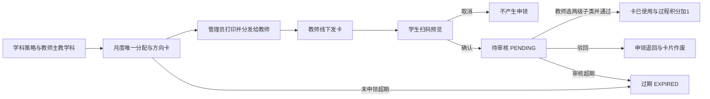
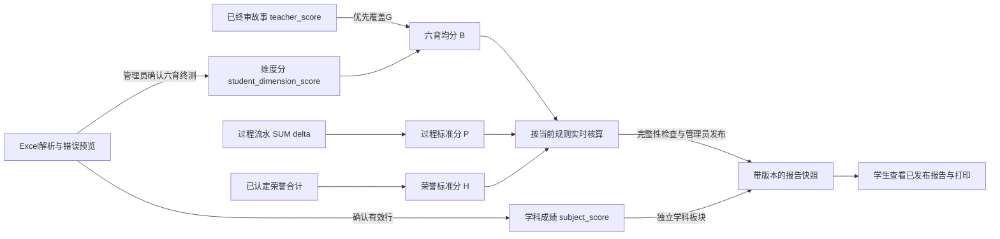
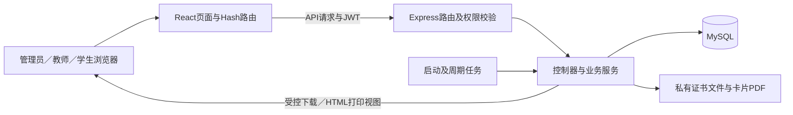

# 六育学生综合素质评价系统

面向学校管理员、教师和学生的评价与成长记录系统，覆盖学期配置、按学科自动配卡、学生扫码申领、教师审核与直评、荣誉认定、月度故事、成绩导入、综合核算和期末报告发布。

系统以**德育 D、智育 Z、体育 T、美育 M、劳育 L、生活故事 G**为六个方向，将日常激励、材料审核、期末评分与报告快照连接起来。本文依据当前代码说明已实现的业务与数据流；设计稿和历史演示资料中的规划功能不等同于已实现功能。

- [角色与功能](#角色与功能)
- [业务规则与数据流](#业务规则与数据流)
- [综合评价如何计算](#综合评价如何计算)
- [系统架构与数据结构](#系统架构与数据结构)
- [本地开发与初始化](#本地开发与初始化)
- [一键完整演示](#一键完整演示)
- [验证与开发约定](#验证与开发约定)
- [构建部署](#构建部署)
- [当前实现边界](#当前实现边界)

## 角色与功能

账号角色由后端用户数据决定，登录后进入对应工作台。管理员的角色值为 `manager`，教师为 `teacher`，学生为 `student`。

| 角色 | 当前菜单与主要操作 | 数据范围 |
| --- | --- | --- |
| 管理员 | 管理概览、学期与校历、六育指标树、评价卡管理、评价卡审核、成绩导入、综合评分规则、报告批量发布、审计与冲销 | 本校配置、学生与业务记录；可接管本校卡片审核 |
| 教师 | 工作台、扫卡审核、无卡直评、荣誉审核、故事评阅、学科成绩导入、我的评价卡 | 本人配卡及卡片申领；直评、材料审核、成绩导入和学生查询按任教班级限制 |
| 学生 | 成长首页、扫卡领取、积分账本、荣誉申报、月度故事、综合评价、学期报告 | 本人申领、材料、积分、实时评价与已发布报告 |

共23个角色菜单入口。教师与管理员共用部分页面，例如 `/admin/cards` 和 `/admin/import`，界面能力和服务端权限按角色区分。前端采用 Hash 路由，实际地址形如 `/#/student/report`。

菜单见 [menu.jsx](frontend/src/constant/menu.jsx)，业务接口与角色限制见 [api.js](backend/routes/api.js)，学生资料范围校验见 [studentScope.js](backend/middleware/studentScope.js)。

## 业务规则与数据流

### 1. 学期与基础配置

管理员维护学年、学期起止日期、启用状态和审核截止时间，查看六育三级指标树，并保存综合评分规则。`is_current` 表示默认展示学期；自动发卡还会检查校历是否启用、是否覆盖当月。

评价指标结构为“六育方向 → 一级子类 → 二级子类”，对应数据库的第1、2、3层。例如：`智育 Z → 勤奋好学 Z01 → 课堂认真专注 Z01-01`。当前指标树页面用于查看，完整树由初始化数据提供。

### 2. 学科策略驱动月度配卡

管理员在评价卡管理中维护学科字典、教师任教学科、主教学科及学科发卡策略。每个学科填写**月总张数和六育比例**，系统计算各方向数量。

| 示例主教学科 | 月总数 | 德育 | 智育 | 体育 | 美育 | 劳育 | 故事 |
| --- | ---: | ---: | ---: | ---: | ---: | ---: | ---: |
| 语文 | 100 | 20% | 70% | 0% | 0% | 10% | 0% |
| 美术 | 100 | 20% | 0% | 0% | 70% | 10% | 0% |

- 每位教师每月只生成一份；兼教多科时，由管理员指定一个主教学科，采用该学科当月生效策略。
- 比例合计必须为100%，支持最多两位小数。数量采用最大余数法取整，同余数按 `D/Z/T/M/L/G` 顺序分配，保证总张数一致。
- 新月份由后台每分钟检查并自动生成当月卡片；服务启动及相关配置保存后也会检查补齐。无需逐教师配置月配额，也无需手动批量制卡。
- 首次启用、月中新入职或补齐主教学科的教师，若当月尚未分配且仍在可申领时间内，补发完整当月份额。
- 某学科当月已有分配后，修改策略从下月生效。新增教师按当月有效版本补发，已生成批次保留策略与数量快照。
- 没有有效学期覆盖的月份暂停配卡。缺主教学科、缺策略、校历冲突、生成失败等情况进入发卡异常清单。
- 以“学校＋教师＋月份”约束唯一分配，并用学校级锁及事务协调配置和生成，避免重复配卡。

管理员准备并下载按教师分组的真实二维码卡片PDF，统一打印、分发。卡面区分六育方向，不印两级子类。重复打印使用原批次，不增加卡片数量。

原教师月配额和手工制卡接口已退役，返回 `410`；数据库中的旧 `card_quota_rule` 表不再驱动正式配卡。规则实现见 [cardRules.js](backend/services/cardRules.js)、[cardAllocationService.js](backend/services/cardAllocationService.js)，打印实现见 [cardPrintService.js](backend/services/cardPrintService.js)。

### 3. 发卡、申领与审核

教师线下将卡交给学生。学生扫码后先预览教师、方向与有效期，再主动确认申领；取消预览不占卡、不加分。未登录扫码时保留领取意图，登录后恢复领取页。



| 阶段 | 卡片状态 | 申领状态 | 对积分的影响 |
| --- | --- | --- | --- |
| 生成／仅预览 | `UNUSED` | 无 | 不加分 |
| 学生确认申领 | `PENDING` | `PENDING` | 待审不加分 |
| 审核通过 | `USED` | `APPROVED` | 写入一条 `B_CARD` 流水，固定 `+1` |
| 审核驳回 | `VOID` | `REJECTED` | 不加分，卡片不恢复流通 |
| 超过适用截止 | `EXPIRED` | 待审申请同步为 `EXPIRED` | 不加分 |

审核通过前，教师必须在卡片对应方向内选择完整两级子类。服务端验证层级、启用状态与指标版本，保存分类路径快照，并在同一事务内更新卡片、申领和积分流水。重复请求受状态、请求标识和唯一约束控制。

未申领卡截至**当月末23:59:59与学期审核截止的较早者**；月底前申领的待审卡，截至**次月3日23:59:59与学期审核截止的较早者**。发卡时间边界按北京时间处理。缩短学期审核截止会收紧既有批次期限，之后延长不会重新放宽这些旧批次。

### 4. 无卡直评与受控纠错

教师可选择任教班级学生及具体成长指标，批量提交无卡直评；每位学生本次固定 `+1`，来源为 `A_DIRECT`。卡片审核和无卡直评共同形成过程账本。

管理员纠正误评时，指定原流水及原因，追加 `REVERSAL` 反向流水；保留原记录，净积分按 `SUM(delta)` 计算，不通过删除原流水纠错。相关操作进入审计记录。

### 5. 荣誉与月度故事

| 业务 | 操作闭环 | 正式计分条件 |
| --- | --- | --- |
| 荣誉 | 学生上传证书申报 → 教师认定或退回 → 退回后补材料重提 → 再次审核 | 仅 `APPROVED` 荣誉累计；不写入过程 `+1` |
| 故事 | 学生保存草稿、修订 → 正式提交 → 教师给出0～100正式分及评语 → 学生查看反馈 | 仅 `REVIEWED` 的教师终审分可覆盖 G 维度；模拟建议分不计入正式总评 |

荣誉等级为区县、市、省三级，分别对应一／二／三等奖 `3/2/1`、`6/5/4`、`9/8/7` 原始荣誉分。例如市级一等奖为6分。退回后重提递增材料版本并回到 `PENDING`，各版证据保存在 `material_revision`。

故事按有效学期提供月份选项，草稿修订形成材料版本；正式提交后不能由学生直接覆盖，教师只能终审已提交故事。当前建议评分由本地篇幅规则模拟，未调用外部大模型。综合核算采用该学期 **ID最新的一条已终审故事**的教师分作为 G；没有已终审故事时，使用已录入的 G 维度分，不计算各月故事平均分。

### 6. 成绩导入、核算与发布



前端解析Excel后展示有效行与错误名单，预览不写入成绩表；确认时服务端重新检查数据与权限，写入批次及审计记录。未知学号、重复学号、非数值或越界分数等进入错误名单，可下载Excel。空单元格与有效的 `0` 分分开处理；成绩更正可再次导入。

教师可导入任教班级的学科期末成绩，六育终测由管理员统一导入。Excel批量预览展示格式和错误校验结果，不提供与数据库旧成绩逐项比较的差异预览。

**学科成绩独立保存在 `subject_score`，进入报告的学科板块；不会自动折算智育分，也不占综合评价中15%的过程权重。** 六育终测、过程积分和荣誉分别进入各自的数据来源。

管理员发布时逐学生检查账号及六维完整性；允许一批中部分成功、部分因缺项受阻。通过后保存身份、核算结果、规则版本、学科及荣誉快照。再次发布生成新版本，旧版标记 `SUPERSEDED`；业务数据更正后需重新发布，已发布快照不会随实时核算自动改变。

学生查看本人已发布报告，打印接口生成带身份水印的HTML打印视图，可使用浏览器打印或另存PDF。路径虽名为 `export-pdf`，当前响应实际是HTML；自动演示会进一步用浏览器将该真实视图保存为PDF。

## 综合评价如何计算

默认规则为六育80%、过程15%、荣誉5%，过程满分目标20分、荣誉满分目标12分。管理员可以保存新规则版本并激活，核算和报告记录实际采用的规则版本。

```text
B = (D + Z + T + M + L + G) / 6
P = min(100, max(0, 过程净积分 / 过程目标 × 100))
H = min(100, max(0, 已认定荣誉积分 / 荣誉目标 × 100))
综合分 = round(B × 六育权重 + P × 过程权重 + H × 荣誉权重, 2)
```

六维必须齐全才能生成综合分，缺项不会当成0；明确录入的0分是有效成绩。六育均分先以原始精度参加加权，最终综合分保留两位小数。过程、荣誉标准分分别封顶100。

演示样本：六维 `92/94/88/90/95/88.5`，均分 `91.25`；过程净分20对应100，荣誉原分6对应50。默认权重下，`91.25×0.8 + 100×0.15 + 50×0.05 = 90.50`，等级为优秀。

报告等级：90分及以上“优秀”，80～不足90“良好”，60～不足80“合格”，不足60“待提升”。计算依据见 [evaluationEngine.js](backend/services/evaluationEngine.js)，发布与快照见 [reportController.js](backend/controllers/reportController.js)。

## 系统架构与数据结构

### 技术栈

| 层次 | 当前技术 |
| --- | --- |
| 前端 | React 18、Vite 5、Ant Design 5、React Router 7、Jotai、Axios、Less、SheetJS/XLSX |
| 后端 | Node.js、Express 5、mysql2、JWT、bcrypt、Multer |
| 数据与打印 | MySQL 8、PDFKit、QRCode、随仓库分发的 Noto CJK 中文字体 |
| 自动演示 | Playwright／Chrome、Python、xlsxwriter、openpyxl、Pillow、ReportLab、Poppler |
| 测试 | Node.js内置 `node:test`，数据库集成回归及真实浏览器全流程演示 |
| 部署 | Express静态托管、Nginx反向代理、PM2；另提供前后端独立Dockerfile |

依赖版本以 [frontend/package-lock.json](frontend/package-lock.json) 和 [backend/package-lock.json](backend/package-lock.json) 为准。



核心API前缀为 `/api/v1`，保留 `/api` 兼容挂载；登录另兼容 `/api/auth/login`。JWT注销使用 `token_blacklist`。敏感业务在后端检查角色、学校和学生范围，不能以隐藏菜单代替服务端校验。

| 数据组 | 核心表及关联 |
| --- | --- |
| 身份与校历 | `users`、`academic_year`；学校隔离，学生年级班级及教师任教班级记录在用户数据中 |
| 指标与规则 | `edu_evaluation_category` 三级树；`comprehensive_score_rule` 按学校、学期及版本保存 |
| 学科发卡 | `card_subject`、`teacher_subject`、`users.primary_subject_id` → `subject_card_policy` → `card_allocation` |
| 卡片与打印 | `reward_card` → `card_claim` → `score_record`；`card_print_pack` 管理打印任务，`card_generation_issue` 记录异常 |
| 材料与正式分 | `honor_record`、`story_submission` → `material_revision`；`student_dimension_score`、`subject_score` 分别保存维度与学科成绩 |
| 报告与追溯 | `term_report.snapshot_json`、`operation_audit`、`notification_outbox`、`token_blacklist` |

卡片只在审核时关联具体叶子指标；正式卡片与历史测试卡隔离。扫码凭证以哈希校验，并以带业务上下文的AES-256-GCM密文保存供重印恢复。打印密钥、数据库与私有文件需要共同备份，PDF本身含可领取凭证。

调度器启动时执行检查，此后每分钟补齐发卡／恢复打印任务，每10分钟扫描过期卡，每30秒处理通知Outbox。具体实现见 [scheduler.js](backend/services/scheduler.js)。完整结构与增量变更见 [00_full_schema.sql](sql/00_full_schema.sql)、[04_subject_card_issuance.sql](sql/04_subject_card_issuance.sql) 和 [迁移程序](backend/migrations/20261026_subject_cards.js)。

### 项目结构

```text
.
├── frontend/                  # 页面、角色菜单、请求封装及前端测试
│   └── src/app/               # admin、teacher、student、dashboard、login
├── backend/
│   ├── controllers/           # HTTP入参、业务组织与响应
│   ├── services/              # 配卡、打印、综合核算、导入与调度
│   ├── middleware/            # 认证、角色、账号及学生范围校验
│   ├── migrations/            # 可重复执行的卡片增量迁移
│   ├── scripts/               # 建表、迁移与基础示例数据
│   ├── assets/fonts/          # 中文PDF字体与字体许可
│   └── __tests__/             # 单元、契约及数据库集成测试
├── sql/                       # 完整表结构与SQL资料
├── scripts/full-system-demo/  # 独立初始化、资料生成和自动浏览器演示
├── deploy/                    # SSH部署、PM2、Nginx和生产配置模板
├── docs/                      # 设计、实施计划、交付资料和验证记录
├── output/full-system-demo/   # 每次演示的独立输出（Git忽略）
└── 完整系统自动演示.command   # macOS双击启动入口
```

## 本地开发与初始化

### 1. 环境与依赖

需要 MySQL 8；Node.js使用 `20.19+` 的20系列或 `22.12+`，以满足当前React插件依赖约束。普通开发不需要Python或Poppler，它们仅用于完整演示资料生成和打印核验。

在项目根目录执行：

```bash
npm ci --prefix backend
npm ci --prefix frontend

# 仅首次创建；已有.env时保留并编辑现有文件
cp -n backend/.env.example backend/.env
cp -n frontend/.env.example frontend/.env
```

编辑 `backend/.env`，至少配置：

```dotenv
DB_HOST=127.0.0.1
DB_PORT=3306
DB_NAME=student_growth
DB_USER=your_db_user
DB_PASSWORD=your_db_password
JWT_SECRET=replace_with_a_random_secret
JWT_EXPIRES_IN=7d
PORT=3000
CORS_ORIGIN=http://localhost:5173
FRONTEND_PUBLIC_URL=http://localhost:5173
TRUST_PROXY=0
CARD_PRINT_KEY=replace_with_32_byte_base64_key
```

打印密钥可用以下命令生成一次，再填入 `CARD_PRINT_KEY`；保持持久化，不在每次启动时重生成：

```bash
node -e "console.log(require('crypto').randomBytes(32).toString('base64'))"
```

`CARD_PRINT_DIR` 可指定私有卡片PDF目录，默认 `backend/private/card-prints`；`UPLOAD_DIR` 可指定证书目录，默认 `backend/uploads`。`FRONTEND_PUBLIC_URL` 应为学生设备实际可访问的前端地址，二维码会使用该地址；手机扫描时不能使用仅本机可访问的 `localhost`。

前端 `VITE_API_SERVER` 开发时可留空，经Vite代理至 `http://localhost:3000`；若更换后端端口，需同步修改 [vite.config.js](frontend/vite.config.js) 的代理目标。

### 2. 建表与基础数据

```bash
npm run migrate --prefix backend
```

迁移入口读取 `DB_NAME`，执行完整建表及卡片增量升级。检测到用户表为空时，会调用基础初始化脚本，创建**示例学期、指标、规则、三角色账号和部分示例业务数据**；它不是只建空表的生产初始化工具。已有用户时不会自动补齐上述示例数据。

| 空库基础初始化账号 | 密码 | 角色 |
| --- | --- | --- |
| `admin` | `admin123` | 管理员 `manager` |
| `teacher1`／`teacher2` | `123456` | 教师 |
| `student1`／`student2`／`student3` | `123456` | 学生 |

这些账号仅供本地测试。示例校历固定为2026—2027学年第一学期，使用前需核对当前校历、账号及教师学科。已有库升级前先备份；不要将旧模板 `backend/scripts/seed.js` 用作本系统的完整初始化入口，也不要在正式库反复手动运行会更新示例数据的 `init_db_data.js`。

### 3. 启动前后端

分别在两个终端执行：

```bash
npm run dev --prefix backend
```

```bash
npm run dev --prefix frontend
```

默认访问 `http://localhost:5173/#/login`；后端默认 `http://localhost:3000`，健康检查为 `GET /api/health`。登录后先核对学期与规则，再配置教师主教学科和学科策略。后台自动发卡需正常启动后端；`NODE_ENV=test` 下不会启动周期任务。

## 一键完整演示

给学校领导或管理员展示时，可双击根目录 [完整系统自动演示.command](完整系统自动演示.command)，或运行：

```bash
node scripts/full-system-demo/run.cjs --check  # 只读检查环境，不建库
node scripts/full-system-demo/run.cjs          # 可见浏览器，完整自动演示
```

入口自动新建唯一的 `liuyu_demo_...` 数据库及运行目录，生成8名虚构学生、两名教师、两班及管理员账号，打开独立Chrome，完成13章、23个角色菜单。**每个可见操作完成后默认停留2.5秒**，最后停在学生报告。按启动终端的 `Ctrl+C` 关闭本次资源。

演示包含：策略配卡与真实PDF／二维码 → 取消预览与确认申领 → 两级审核 → 直评与误评冲销 → 荣誉退回重提 → 故事修订终审 → 错误／正确／更正成绩导入 → 六育缺项发布阻断与补齐 → 8人独立对账 → 报告再发布及真实打印PDF。

演示需要Playwright、Chrome或Chromium，以及Python的 `xlsxwriter/openpyxl/Pillow/reportlab`、Poppler的 `pdftoppm/pdftotext`。本机可复用已安装的捆绑运行时，其他机器的依赖与参数见 [自动演示说明](scripts/full-system-demo/README.md)。

每次资料和证据位于 `output/full-system-demo/<运行编号>/`，包括账号表、策略表、导入Excel、模拟证书、故事稿、核算表、讲稿、流程图、截图、录像、trace、下载和实际状态报告。业务结果通过真实UI产生，API／SQL仅用于只读对账；意外失败停止并保存非成功结果。原业务库、原 `.env` 与旧运行资料不被重置。

完整资料索引见 [演示交付目录](docs/delivery/full-system-demo/README.md)。原手工MCP演示资料为历史存档，当前一键脚本及每次运行报告是自动演示的依据。

## 验证与开发约定

### 验证命令

```bash
npm test --prefix frontend
npm run build --prefix frontend
node --test scripts/full-system-demo/*.test.cjs
```

后端测试含真实数据库读写、迁移、导入和打印集成测试，应先创建专用测试库，不能指向生产库或需要保留的演示终态库：

```bash
DB_NAME=student_growth_test npm run migrate --prefix backend
DB_NAME=student_growth_test npm test --prefix backend
```

需要重新完整验证浏览器流程时可显式加速并自动关闭资源：

```bash
node scripts/full-system-demo/run.cjs --speed 6 --exit
```

`--speed` 会缩短动作停留时间，面向观众演示使用默认命令。自动运行报告记录章节、菜单及8名学生的独立核对，不能用历史通过次数代替当前环境的验证。

### 开发与贡献

- 页面和菜单分别维护在 `frontend/src/app/`、`frontend/src/constant/menu.jsx`；API路径维护在 `frontend/src/constant/urls.js`。
- 新业务按路由、控制器、服务组织；复用后端角色、学校及学生范围校验。卡片生成、审核与积分入账需保持事务、唯一约束和可重试语义。
- 修改评分来源、权重、截止或状态流转时，同步调整回归用例与文档；先在独立测试库验证，再进行界面核验。
- 数据结构改动提供可重复执行的迁移，并核对完整SQL与后端部署包中的增量SQL。不要仅在本机手工改表。
- 不提交 `.env`、真实师生资料、打印密钥、卡片凭证或本机运行证据；提交前检查差异和相关测试结果。

当前仓库没有 `.github/copilot`、`copilot-instructions.md` 或GitHub Actions工作流；本文依据代码、依赖清单和已交付资料整理，不声明不存在的CI状态或额外分支规范。

## 构建部署

```bash
npm run build --prefix frontend
mkdir -p backend/dist
cp -R frontend/dist/. backend/dist/
NODE_ENV=production npm start --prefix backend
```

前端构建结果先位于 `frontend/dist`；Express实际托管的是 `backend/dist`，需要复制。也可用Nginx直接托管静态文件并将 `/api/` 代理至后端。

仓库提供 [部署脚本](deploy/deploy.sh)、[PM2配置](deploy/ecosystem.config.js)、[Nginx模板](deploy/nginx/student_growth.conf.template) 和 [生产环境模板](deploy/backend.env.example)。使用部署脚本前准备 `deploy/.env` 与 `deploy/backend.env` 并核对服务器路径；PM2配置包含默认绝对部署路径，换目录时需同步调整。后端生产启动不会自动执行数据库迁移，应单独完成迁移检查。

部署时保持 `CARD_PRINT_KEY`、证书上传目录与私有卡片PDF目录持久化，并将二维码前端地址改为实际域名。Nginx后的 `TRUST_PROXY` 按代理层数设置，CORS使用实际前端来源。

[前端Dockerfile](frontend/Dockerfile) 与 [后端Dockerfile](backend/Dockerfile) 可分别构建镜像；当前仓库没有Docker Compose编排文件，不能直接执行旧README中的 `docker-compose up` 完成部署。

## 当前实现边界

| 项目 | 当前行为 |
| --- | --- |
| 指标与人员 | 指标树页面只读；教师学科可维护，尚无完整的学校组织和人员增删改界面 |
| 故事建议 | 本地篇幅规则模拟，未接入真实大模型；终审分由教师确认 |
| 报告门禁 | 当前检查账号及六维完整性，不将设计稿中“六项独立门禁”全部视为已实现 |
| 报告文案 | 发布时填入默认评语、自述及家长寄语，尚无完整的班主任确认或家长签署流程 |
| 导出形式 | 卡片由服务端生成PDF；学生报告接口返回HTML打印视图，PDF由浏览器打印生成 |
| 通知 | Outbox已有表和轮询，外部渠道发送目前为模拟标记，未接入真实短信或钉钉服务 |

相关业务细节与历史验证记录见 [学科发卡交付说明](docs/delivery/subject-card-issuance/README.md)、[自动演示验证记录](docs/delivery/full-system-demo/自动演示验证与修复.md)。更早的设计图用于理解规划，实际行为以当前代码及相应验证记录为准。

## 许可

仓库未提供项目级开源许可证。随附Noto CJK字体按其独立 [OFL许可](backend/assets/fonts/OFL.txt) 分发，详见 [字体说明](backend/assets/fonts/README.md)。

## 六表期末报告核心系统（2026-10-28）

当前应用入口已改为三角色的六来源工作台。使用Node >=22.12、MySQL >=8.0.21；原44表迁移脚本不用于新库。

1. 按`deploy/backend.env.example`配置`backend/.env`，目标使用`REPORT_DB_NAME=liuyu_report_pilot`或专用prod库，指定SCHOOL_ID。密钥仅留本地。
2. 全新库运行`node backend/scripts/initReportCore.js`；本机虚构演示可加`--demo`。随机账号密码保存到被忽略的`output/report-core/local-accounts.json`，控制台不会输出密码。已有用户拒绝再次初始化。
3. 后端`npm start --prefix backend`；前端`npm run dev --prefix frontend -- --host 127.0.0.1`。前端默认代理3000，其他端口设置`VITE_API_TARGET=http://127.0.0.1:后端端口`。
4. 学生：扫码、奖状、月度故事、自评、报告；教师：直评/制卡/导入/材料审核/结算/报告确认；管理员：配置/学籍健康导入/卡总额度/全校发布。
5. 故事每月读听讲各1–3篇。自动调用真实LLM；失败不计0分，支持重试与教师异常复核。奖状仅生成已认定成果，劳美不发卡。

完整验证记录见`docs/delivery/report-core/验收清单.md`，迁移与回退见`deploy/report-core-cutover.md`。原未分类卡和旧总分不能自动推断成新分项。上线前须通过学校版式、规则、模型供应方、素材迁移及回退验收。
