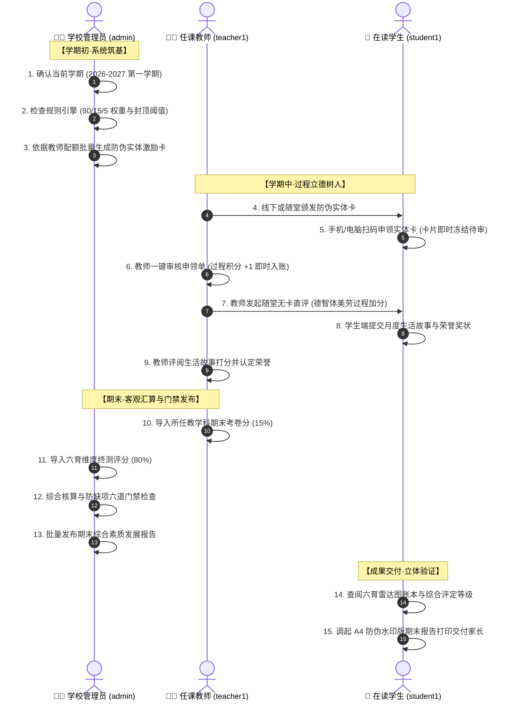

# 功能操作汇报手册

## 目录

1. [演示价值主张与业务主线](#一演示价值主张与业务主线)
2. [演示准备与配套物料清单](#二演示准备与配套物料清单)
3. [三角色功能闭环流程图](#三三角色功能闭环流程图)
4. [第一阶段：管理员端（顶层治理与规则中枢）](#四第一阶段管理员端顶层治理与规则中枢)
5. [第二阶段：日常过程评价互动（师生高频立德树人）](#五第二阶段日常过程评价互动师生高频立德树人)
6. [第三阶段：期末终审汇算与发布（高可靠风控门禁）](#六第三阶段期末终审汇算与发布高可靠风控门禁)
7. [第四阶段：学生端成果交付与报告打印（评价兑现）](#七第四阶段学生端成果交付与报告打印评价兑现)
8. [客户汇报核心亮点与答辩话术](#八客户汇报核心亮点与答辩话术)

---

## 一、演示价值主张与业务主线

本系统全面贯彻国家《深化新时代教育评价改革总体方案》精神，坚决克服“唯分数、唯升学”顽瘴痼疾，构建**德育、智育、体育、美育、劳动教育、月度生活故事**六维并举的立体评价体系：

```
                    ┌──────────────────────────────────────────────┐
                    │       学生期末综合素质发展总分 (100分)       │
                    └──────────────────────┬───────────────────────┘
                                           │
         ┌─────────────────────────────────┼─────────────────────────────────┐
         ▼                                 ▼                                 ▼
┌──────────────────┐             ┌──────────────────┐             ┌──────────────────┐
│ B · 六育底表均分  │             │ P · 过程标准分   │             │ H · 荣誉标准分   │
│   (权重占比 80%)  │             │   (权重占比 15%)  │             │   (权重占比 5%)   │
├──────────────────┤             ├──────────────────┤             ├──────────────────┤
│ • 文化学科期末分 │             │ • 教师随堂直评   │             │ • 校内外竞赛奖励 │
│ • 六育主观终测分 │             │ • 防伪卡扫码申领 │             │ • 先进个人荣誉   │
│ • 生活故事终审分 │             │ (20分目标阈值封顶)│             │ (12分目标阈值封顶)│
└──────────────────┘             └──────────────────┘             └──────────────────┘
```

演示贯穿**“学期初配额与规则设定 ➔ 日常高频师生激励互动 ➔ 期末终审汇算与门禁发布 ➔ 报告交付”**四个自然推进阶段，展现无缝业务闭环。

---

## 二、演示准备与配套物料清单

演示物料位于项目的 `demo_materials/` 目录中，支持即开即用：

| 编号   | 物料文件名                                                                                                       | 文件类型      | 适用演示环节        | 作用与特点                                                     |
| :----- | :--------------------------------------------------------------------------------------------------------------- | :------------ | :------------------ | :------------------------------------------------------------- |
| **01** | [`01_演示账号与操作清单.xlsx`](../../academic_yeardemo_materials/01_演示账号与操作清单.xlsx)                     | Excel / CSV   | 全程快速切换登录    | 列明系统三角色账号、密码、所辖班级与各角色演示任务卡           |
| **02** | [`02_期末文化课成绩导入表_示例.xlsx`](academic_yeardemo_materials/02_期末文化课成绩导入表_示例.xlsx)             | Excel / JSON  | 教师/管理员导入     | 包含语数英三科成绩标准格式，另附 JSON 文本框一键粘贴文件       |
| **03** | [`03_六育主观维度终测评分导入表_示例.xlsx`](academic_yeardemo_materials/03_六育主观维度终测评分导入表_示例.xlsx) | Excel / JSON  | 管理员终测导入      | 包含 D/Z/T/M/L/G 六育终测分标准格式，另附 JSON 即用文件        |
| **04** | [`04_六育防伪实体激励卡_A4打印样张.html`](academic_yeardemo_materials/04_六育防伪实体激励卡_A4打印样张.html)     | HTML (A4排版) | 管理员发卡/学生领卡 | 浏览器直接打开，支持 A4 彩色打印剪裁，卡面含防伪序列号与二维码 |
| **05** | [`05_学生荣誉奖项证明材料_示例.png`](academic_yeardemo_materials/05_学生荣誉奖项证明材料_示例.png)               | PNG 真实图片  | 学生端申报荣誉      | 模拟科技创新竞赛获奖证书原件，用于展示证书上传与图片防伪预览   |

### 演示角色账号速查

| 角色           | 账号       | 初始密码   | 真实姓名   | 演示角色定位                                          |
| :------------- | :--------- | :--------- | :--------- | :---------------------------------------------------- |
| **学校管理员** | `admin`    | `admin123` | 系统管理员 | 演示总控：校历维护、规则配置、防伪制卡、报告发布      |
| **任课教师**   | `teacher1` | `123456`   | 张老师     | 演示主体：四年级（1）班班主任兼语文教师，日常激励审核 |
| **平行班教师** | `teacher2` | `123456`   | 李老师     | 演示对照：五年级（1）班任课教师，多班级协同教学       |
| **核心学生**   | `student1` | `123456`   | 王小明     | 演示主角：四年级（1）班，完整成长轨迹体验             |
| **对比学生**   | `student2` | `123456`   | 李小华     | 演示对照：四年级（2）班，平行班级数据参照             |

---

## 三、三角色功能闭环流程图



---

## 四、第一阶段：管理员端（顶层治理与规则中枢）

### 1.1 学期与校历管理

- **操作路径**：左侧菜单 ➔ `学期与校历`（`AdminTerms`）
- **讲解要点**：
  1. 系统支持多学年、多学期独立归档，保障历史评价报告永久可查且不可篡改；
  2. 演示“设为当前学期”功能：点击操作列【设为当前学期】，顶栏与系统全局仪表盘即时同步生效；
  3. 强调安全防呆机制：新建学期默认不会强制顶替现有当前学期，杜绝误操作导致在校师生评价中断。

### 1.2 综合评价规则引擎

- **操作路径**：左侧菜单 ➔ `综合评价规则`（`AdminRules`）
- **讲解要点**：
  1. **权威权重三元组**：公式严格执行 $综合得分 = 80\% \times B + 15\% \times P + 5\% \times H$；
  2. **满分目标阈值折算**：
     - **过程标准分 $P$**：设置满分目标阈值（默认 20 分），当学生平时累计积分达到 20 分即可折算为 100 分满分，鼓励学生在日常一点一滴中积累进步；
     - **荣誉标准分 $H$**：设置满分目标阈值（默认 12 分），避免盲目“唯证书论”带来的内卷；
  3. **动态生效与版本审计**：保存新规则后系统即时动态显示版本号（如 `V2026-1`）与全校在册学生数，不可变审计留痕。

### 1.3 实体卡配额分配与防伪批量制卡

- **操作路径**：左侧菜单 ➔ `实体卡发放管理`（`AdminCards`）
- **讲解要点**：
  1. **点击【查看教师配额一览】**：展示学校按月为班主任及任课教师配置的卡片额度上限（如张老师每月 50 张），有效防止发卡泛滥；
  2. **点击【批量生成实体卡】**：
     - 选择发放教师：选择“张老师”后，系统自动带出其剩余额度；
     - 实时动态进度条：分配各维度张数时，进度条实时计算累计分配比例并动态显示安全百分比；
     - 点击确定生成：系统瞬间生成带有全局唯一序列号（如 `CARD-202610-D0101-00101`）的防伪实体卡。
  3. **现场物料展示**：
     - 双击打开演示物料 [`04_六育防伪实体激励卡_A4打印样张.html`](academic_yeardemo_materials/04_六育防伪实体激励卡_A4打印样张.html)；
     - 向客户展示实物卡打印样式：涵盖卡片编号、德智体美劳专属配色、六育徽标及二维码，向学校说明“无需高昂定制成本，普通 A4 纸或卡纸即可打印使用”。

---

## 五、第二阶段：日常过程评价互动（师生高频立德树人）

退出管理员账号，使用教师账号 `teacher1`（密码 `123456`）登录。

### 2.1 教师端工作台待办总览

- **操作路径**：登录后默认进入 `教师工作台`（`Dashboard`）
- **讲解要点**：
  1. 智能化时间问候（根据当前时间呈现“张老师，早上好/下午好”），消除重复称谓；
  2. 待办事项红绿徽标：一目了然提示当前“扫卡待审核”、“荣誉待审核”、“故事待评阅”数量，教师日常工作一分钟理清。

### 2.2 教师端随堂无卡直评（A模式：即时敏捷加分）

- **操作路径**：左侧菜单 ➔ `日常无卡直评`（`TeacherDirectScore`）
- **讲解要点**：
  1. **多选学生**：点击勾选“王小明”、“李小华”等学生（学生头像展示规范中文姓氏）；
  2. **选取指标**：在六育评价树中选择【德育 ➔ 文明礼仪 ➔ 主动礼貌问候 (+1分)】；
  3. **一键直评**：点击【提交直评入账】，积分毫秒级写入后台流水，并自动记录审计日志。

### 2.3 学生端扫码申领实体卡（B模式：线下物理防伪申领）

退出教师账号，在另一窗口（或隐私窗口）登录学生账号 `student1`（王小明，密码 `123456`）。

- **操作路径**：学生端左侧菜单 ➔ `扫码领取评价卡`（`StudentClaim`）
- **操作步骤**：
  1. 在卡片序列号输入框中输入刚刚生成的卡号：`CARD-202610-D0101-00101`（或物料样张中的卡号）；
  2. 点击【校验卡片真实性】：系统即时反查出该卡归属教师（张老师）与加分指标（主动礼貌问候 +1 分）；
  3. 点击【确认申领此卡】：状态立刻更新为【申领审核中 (待教师核准)】，卡片即刻锁定防刷。

### 2.4 教师端一键核验核销

切换回教师账号 `teacher1`。

- **操作路径**：左侧菜单 ➔ `评价卡审核`（`TeacherClaims`）
- **操作步骤**：
  1. 看到王小明刚刚提交的申领记录，点击【通过核销】；
  2. 学生王小明的过程积分实时 +1，实体卡状态正式核销归档（避免二次重复利用）。

### 2.5 学生端月度生活故事提交与教师终审

1. **学生端提交故事**：
   - 学生 `student1` 进入 `生活故事`（`StudentStories`）；
   - 查看本月写作小灵感，输入标题《我和小树一起长大》，点击【提交本月故事】；
2. **教师端终审评分**：
   - 教师 `teacher1` 进入 `故事评阅`（`TeacherStories`）；
   - 查阅王小明提交的作文正文，在评分栏录入终审分 `92` 分，并输入暖心评语：“观察细致，记录真实，老师为你点赞！”；
   - 点击【确认终审】，生活故事终审分正式确立为第六维度（G）关键成绩。

### 2.6 学生端个人荣誉申报与教师证书查验

1. **学生端申报荣誉**：
   - 学生 `student1` 进入 `我的荣誉`（`StudentHonors`）；
   - 点击【申报新荣誉】，项目名称填写“海淀区青少年科技创新大赛”，选择【市级 · 一等奖（+3分）】；
   - 上传证明材料：点击上传，选择物料中的真实样例图 [`05_学生荣誉奖项证明材料_示例.png`](academic_yeardemo_materials/05_学生荣誉奖项证明材料_示例.png)；
   - 回车键防误触保护，确认无误后点击提交；
2. **教师端查验认定**：
   - 教师 `teacher1` 进入 `荣誉认定`（`TeacherHonors`）；
   - 预览学生上传的奖状原件，确认属实后点击【认定通过】；
   - 荣誉积分立即计入王小明学期台账。

---

## 六、第三阶段：期末终审汇算与发布（高可靠风控门禁）

### 3.1 教师端导入任教学科期末考卷分

使用教师 `teacher1` 登录。

- **操作路径**：左侧菜单 ➔ `期末成绩导入`（`AdminImport`）
- **讲解要点**：
  1. **角色权限自动隔离**：教师端界面自动隐去权重 80% 的主观终测 Tab，仅保留【任教学科期末成绩】导入权限；
  2. **双模态高可靠对比预览**：
     - 打开物料 [`02_期末文化课成绩导入_文本框即用.json`](academic_yeardemo_materials/02_期末文化课成绩导入_文本框即用.json) 全选复制；
     - 粘贴至数据文本框，点击【预览变更 (与现有成绩对比)】；
     - 系统清晰列出每条记录的新增（NEW）或变更（UPDATE）对比，确认无误后点击【确认导入】，生成不可伪造的专属导入批次号。

### 3.2 管理员端导入六育主观维度终测分

退出教师，登录管理员 `admin`。

- **操作路径**：左侧菜单 ➔ `成绩导入中心`（`AdminImport`）
- **讲解要点**：
  1. 点击 Tab 2【六育主观维度终测评分 (占总评80%)】；
  2. 打开物料 [`03_六育主观维度终测评分_文本框即用.json`](academic_yeardemo_materials/03_六育主观维度终测评分_文本框即用.json) 复制粘贴；
  3. 点击【预览变更】：系统清晰展示 `【D】德育终测分`、`【Z】智育终测分`、`【T】体育终测分`、`【M】美育终测分`、`【L】劳育终测分`、`【G】生活故事终测分`，点击【确认导入】批量入库。

### 3.3 期末报告批量发布与防缺项六道门禁

- **操作路径**：左侧菜单 ➔ `期末报告发布中心`（`AdminReports`）
- **核心演示爆点（客户最关切的防呆与风控）**：
  1. **明确学期选择器**：顶部下拉框清晰标明“当前生效学期：2026-2027 第一学期”，支持按需选择历史学期补发；
  2. **点击【批量发布期末报告】**：
     - 系统自动对全选学生执行严格的**六道防缺项门禁检验**；
     - 若学生任一维度缺失（如未录入体育分），门禁会自动拦截并给出明确提示：“六育正式终测分不全，缺项不按0分计算，报告发布已拦截”；
     - 维度齐全的受评学生（王小明）顺利通过门禁，期末快照计算完成，状态变为绿色【已发布】。
  3. **审计留痕**：切换至 `操作审计日志`，向客户展示发布操作已生成带时间戳、操作人 IP 与影响学生计数的不可变日志。

---

## 七、第四阶段：学生端成果交付与报告打印（评价兑现）

登录学生账号 `student1`（王小明）。

### 4.1 综合评价雷达图与台账查阅

- **操作路径**：学生端左侧菜单 ➔ `我的六育账本`（`StudentLedger`）及 `综合评价`
- **讲解要点**：
  1. 展示涵盖“德、智、体、美、劳、生活故事”的六维雷达图，直观展现学生的全面素质模型与优势特长；
  2. 台账清晰列明每一笔过程积分的来源（如“张老师随堂直评 +1分”、“主动礼貌问候卡 +1分”），做到底表真实、可信、可追溯。

### 4.2 期末综合素质发展报告预览与带水印 A4 打印

- **操作路径**：学生端左侧菜单 ➔ `期末发展报告`（`StudentReports`）
- **终极大招展示**：
  1. **报告标准规范**：
     - 综合评定等级：**优秀**（综合得分 93.8 分）；
     - B/P/H 三元组合成展示：六育终测均分 80% + 过程积分标准分折算 15% + 荣誉积分标准分折算 5%；
     - 教师温暖寄语与成长雷达图全景映射；
  2. **带水印 A4 打印**：
     - 点击【导出 / 打印纸质报告】，页面自动渲染标准的 A4 红头报告排版；
     - 背景带有学生专属防伪暗纹水印与教务处印章样式；
     - 演示调起浏览器的打印预览窗口（Ctrl+P / Command+P），直接生成可分发给家长的纸质官方报告单。

---

## 八、客户汇报核心亮点与答辩话术

在演示过程中，针对校方决策层最容易提出的痛点问题，可结合以下核心亮点与标准话术应答：

### Q1：很多学校老师反映日常评价太耗时，这个系统会不会增加老师负担？

> **答辩话术**：  
> “我们专门针对一线减负设计了**‘极简双模态’**机制：
>
> 1. 随堂评价时，老师只需在手机上点选学生名字，一秒完成无卡直评；
> 2. 实体卡模式将‘录入权’交还给学生（学生扫码申领），老师只需在课间点击‘一键通过’即可完成核销。  
>    全学期日常评价无需填写冗长表格，老师每天仅需花费两分钟即可完成全班激励。”

### Q2：部分学生某项终测成绩因病缺考，系统会不会直接按 0 分算，把总成绩拉得很低？

> **答辩话术**：  
> “绝对不会！我们系统坚持**‘缺项必须完善，绝不草率赋 0 分’**的育人风控原则。  
> 在期末报告发布中心，系统内置了六道防缺项自动化门禁。只要学生缺少任何一个维度的测评分，系统就会自动拦截该报告并高亮告警，提醒教务老师进行缓考或补测，坚决保障每一位孩子的教育权益。”

### Q3：实体激励卡会不会被学生冒领、互相盗刷或者重复使用？

> **答辩话术**：  
> “系统采用了**‘一卡一密、全局唯一序列号、教师按月严格配额’**的三重防伪体系：
>
> 1. 每张实体卡都有系统分配的唯一防伪编号；
> 2. 学生输入卡号申领后，卡片在系统中瞬间锁定并进入‘冻结待审’状态，他人无法再次录入；
> 3. 必须由最初发卡的任课教师本人在后台核准通过，该卡方能完成核销并计入账本。全程闭环，彻底杜绝冒领与重复使用。”

### Q4：我们学校几千名学生的文化课成绩都在 Excel 表里，导入会不会频繁格式报错？

> **答辩话术**：  
> “系统配备了**‘双模态高可靠导入引擎’**：
>
> 1. 支持直接拖入 Excel 标准模版，或将表格内容一键复制粘贴；
> 2. 导入入库前，系统会自动与数据库进行逐行智能比对，清晰用绿色标出‘新增数据’、用橙色标出‘修正变动’、用红色明确标出‘错误学号或缺考行’；
> 3. 老师在界面核对无误后点击‘确认导入’才会落盘，并生成永久唯一的导入批次号，哪怕不小心导错也能根据批次号秒级追溯和撤销。”

---

### 附：演示准备快速自查 Checklist

- [ ] 演示服务器正常运行（无报错）；
- [ ] 打印并裁剪物料中的 2~3 张 [`04_六育防伪实体激励卡_A4打印样张.html`](academic_yeardemo_materials/04_六育防伪实体激励卡_A4打印样张.html) 放于讲台；
- [ ] 桌面存放 [`02_期末文化课成绩导入_文本框即用.json`](academic_yeardemo_materials/02_期末文化课成绩导入_文本框即用.json) 与 [`03_六育主观维度终测评分_文本框即用.json`](academic_yeardemo_materials/03_六育主观维度终测评分_文本框即用.json)；
- [ ] 桌面存放奖状样例图 [`05_学生荣誉奖项证明材料_示例.png`](academic_yeardemo_materials/05_学生荣誉奖项证明材料_示例.png)；
- [ ] 准备两台设备或两个浏览器窗口（窗口 A 管理员/教师，窗口 B 学生）。
