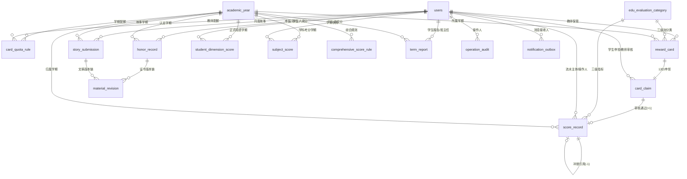
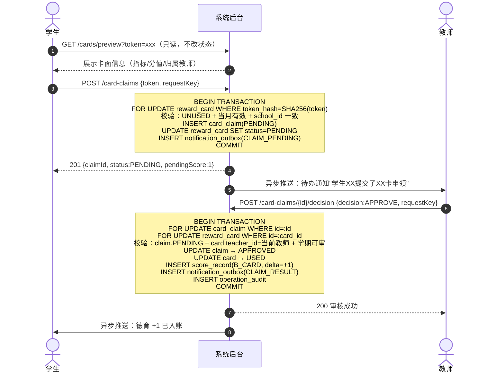
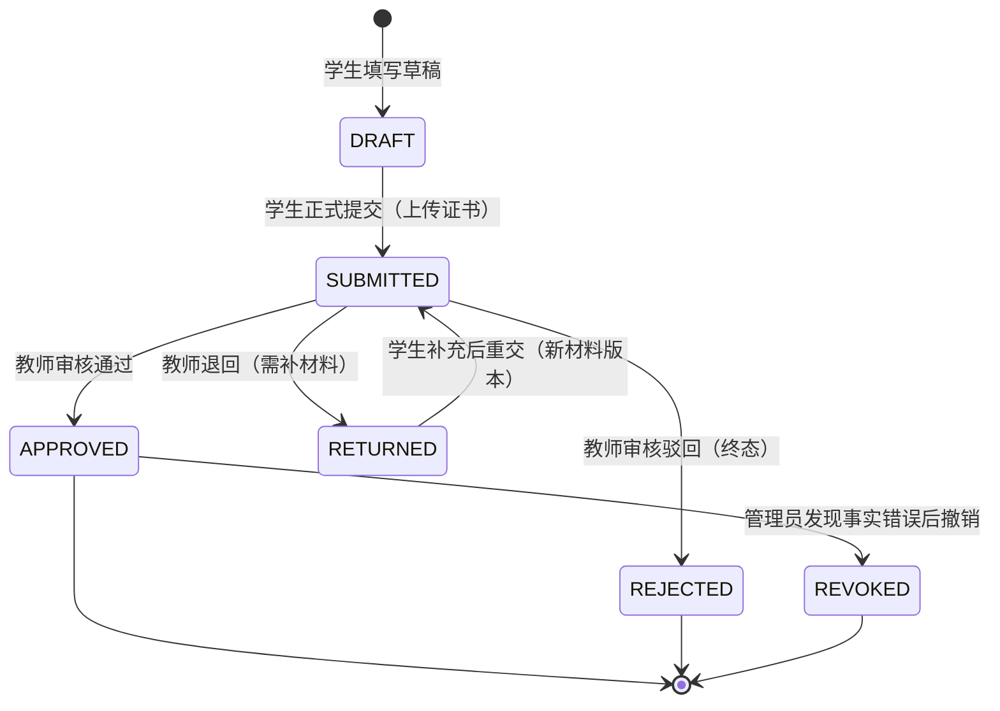
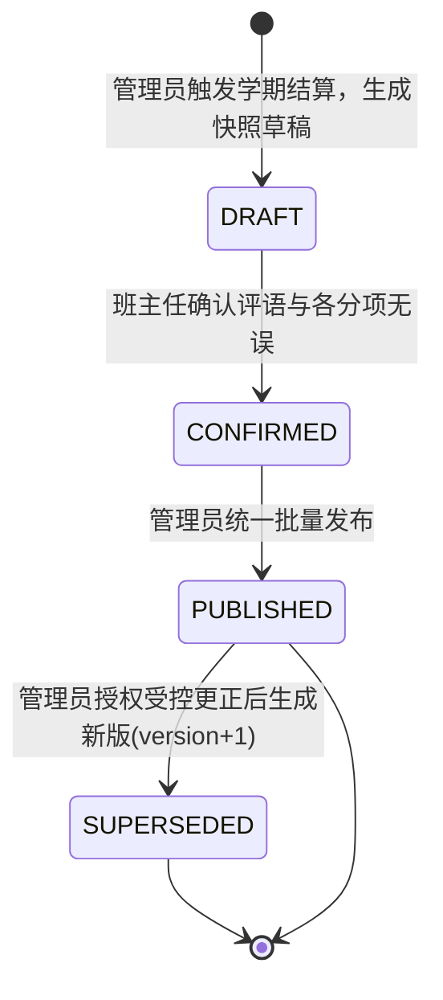
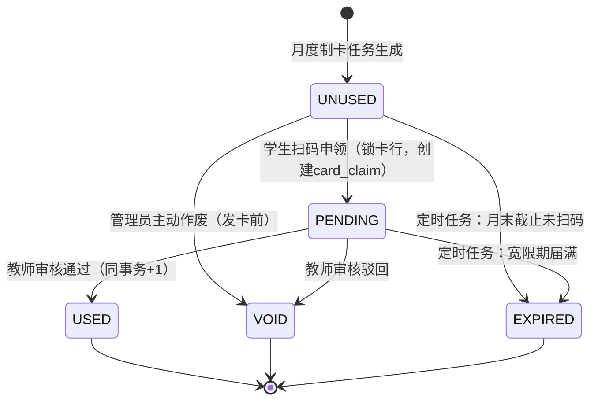
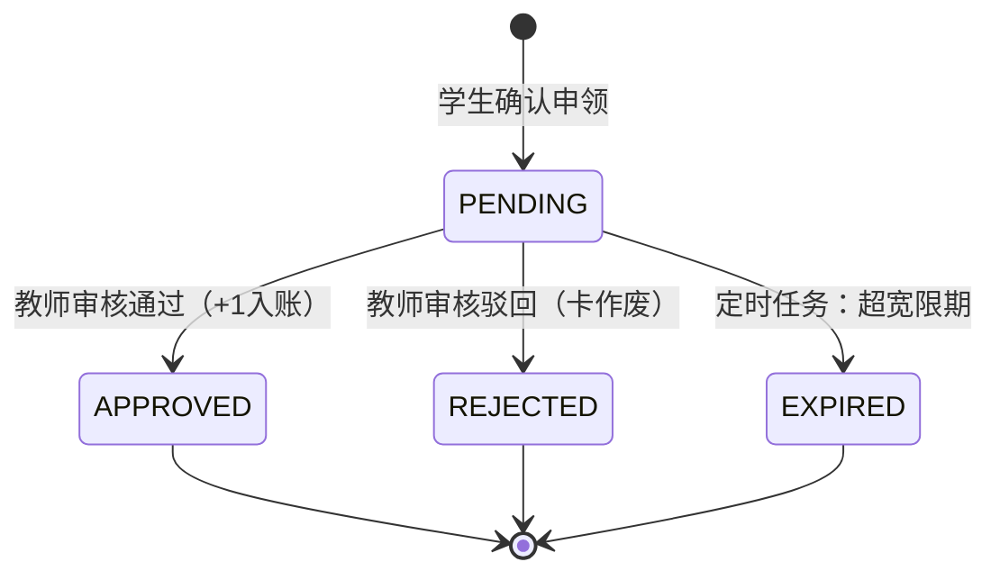
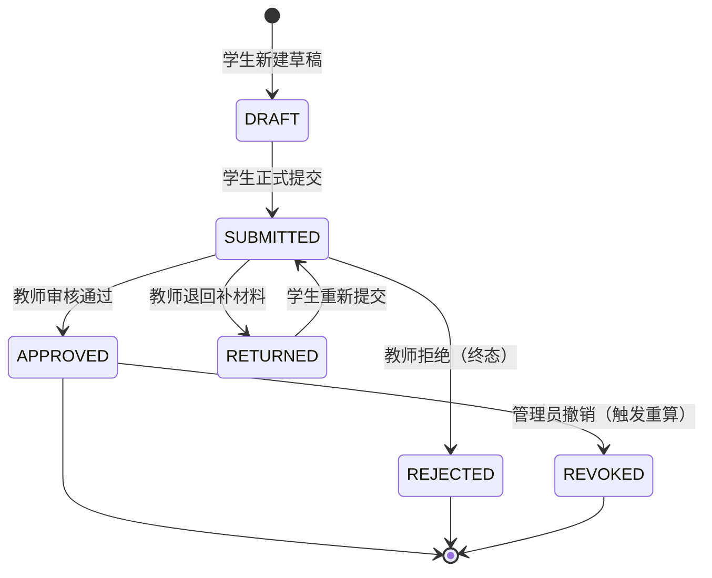
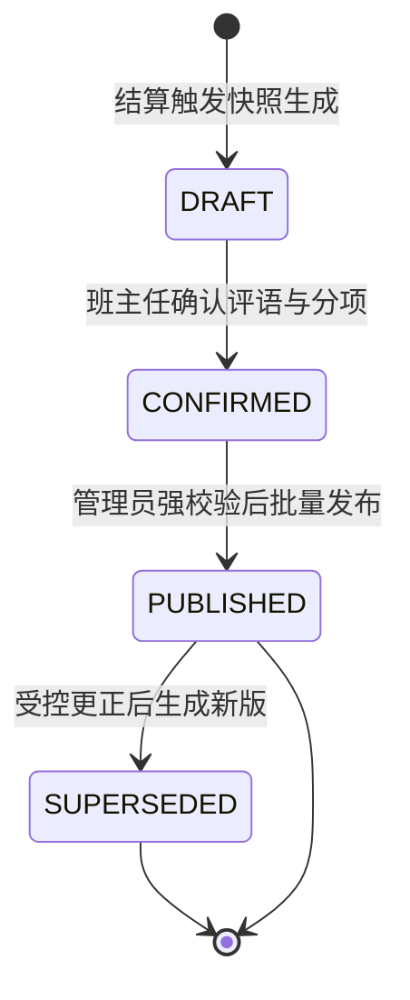

# 学生学期综合素质评价系统

## 软件需求规格说明书（SPEC / SRS）

**版本**：V2.1（首席架构师审核终稿）  
**制定日期**：2026-10-22  
**适用角色**：学生（`student`）、教师（`teacher`）、管理员（`manager`）  
**底层数据基准**：MySQL 8.0.16+ / InnoDB / utf8mb4 / utf8mb4_0900_ai_ci  
**配套SQL脚本**：[sql/00_full_schema.sql](file:///Users/quanta/Downloads/task/六育学生评价系统v2/sql/00_full_schema.sql)（共 16 张逻辑业务表）  
**配套数据库设计**：[spec/数据库详细设计说明书.md](file:///Users/quanta/Downloads/task/六育学生评价系统v2/spec/数据库详细设计说明书.md)

> **V2.1 修订说明**：相较 V2.0，本版本经五轮对抗推演，修复了 18 项逻辑漏洞，核心补充：定时任务驱动卡片过期的闭环、荣誉撤销级联重算机制、报告发布前置条件强校验、学期归档与受控更正的状态边界厘清、`academic_year` 多校唯一键修正、综合得分计算触发时机、AI 降级 UX 与 PDF 异步导出策略、超管代审触发条件及高危接口入参规范。

---

## 0. 核心架构决议与 V2.0 → V2.1 修订对比

| 关键决议 | V2.0 状态 | V2.1 修复/补充 |
| :--- | :--- | :--- |
| 实体卡 EXPIRED 驱动者 | 仅描述"自动标记" | **新增：定时任务规范（幂等、失败降级）** |
| 荣誉撤销级联 | 未覆盖 REVOKED 状态 | **新增：REVOKED 状态机与报告重算触发** |
| 报告发布前提条件 | 无明确门禁 | **新增：发布前强校验清单（6 项）** |
| 归档后受控更正矛盾 | 逻辑矛盾（只读 vs 可更正） | **修复：明确归档分层只读边界** |
| `academic_year` 唯一键 | 缺少 `school_id` | **修正：唯一键为 `(school_id, academic_year, semester)`** |
| `rule_status` 枚举 | 未定义 | **新增：DRAFT/ACTIVE/DEPRECATED 枚举与激活规则** |
| 导入 OOM 防护 | 无文件大小限制 | **新增：单文件 ≤ 2MB / 1000 行硬限制** |
| AI 降级 UX | 仅一句话描述 | **新增：明确降级状态枚举与前端展示规范** |
| 综合得分触发时机 | 未定义 | **新增：计算触发条件与 INCOMPLETE 展示规则** |
| 超管代审条件 | "带审计"无细节 | **新增：触发条件、鉴权约束与审计区分规范** |

---

## 1. 建设目标、业务范围与核心业务不变量

### 1.1 建设目标

建设一套全流程可追溯、防并发抢占、不可篡改、支持多版本留痕的"六育"（德 D、智 Z、体 T、美 M、劳 L、故事 G）中小学生学期综合素质评价系统：

1. **学生端**：查阅每笔过程积分来源、便捷申报荣誉材料、每月提交生活故事、查阅并下载带水印的期末综合素质发展报告。
2. **教师端**：便捷开展无卡直评（A模式）、移动端审阅学生扫卡申领（B模式）、审阅荣誉材料与生活故事、撰写期末综合评语。
3. **管理端**：配置学年学期与关键时间窗、按月为教师定额生成实体卡印刷资产、批量导入学科与五育成绩、统一核算综合得分、定向发布与归档学期报告。

### 1.2 系统边界（明确不做）

- **不设独立家长账号**：家长寄语仅作为报告内容模块，由学生代录并标记 `STUDENT_TRANSCRIBED`。
- **不设前台学生异议申诉**：学生端无在线争议工单入口；差错由管理端走受控冲销流水纠正。
- **不设积分转赠与兑换**：过程积分仅作综合评价发展性证据，无代币属性。
- **实体卡不预绑学生、不二次复用**：按月配发给教师，线下发放，系统不创建发放登记。
- **禁止客户端提交分值**：所有加分值严格由系统规则枚举控制（直评/扫卡固定 +1，荣誉分由等级公式生成）。

### 1.3 核心业务不变量（Invariants）

1. **增量固定性**：A/B 模式单次正式记账 **必须且只能是 +1**，严禁客户端传入任意分值。
2. **单卡唯一终态性**：一张实体卡最多产生一条有效申领记录，最多成功入账一次。终态（`USED / VOID / EXPIRED`）不可逆转。
3. **账本不可篡改性**：`score_record` 严禁 `UPDATE` 或 `DELETE`。纠错必须追加 `-1` 冲销流水，且唯一约束 `uk_score_reversal_original` 保证同一笔正向流水至多被冲销一次。
4. **成绩数据线物理隔离**：六育正式分、过程积分流水、荣誉认定分、学科考试成绩四类数据严格分表存储，禁止跨类合并计算。
5. **多租户硬隔离**：所有业务写接口必须强制附加 `AND school_id = :caller_school_id`，禁止跨校穿透。

---

## 2. 用户角色与权限控制矩阵

| 功能模块 | 学生 | 教师 | 管理员 |
| :--- | :---: | :---: | :---: |
| 查阅个人信息 | 仅本人 | 本人 + 任教班级 | 全校 |
| 六育过程积分查阅 | 仅本人 | 任教班级 | 全校穿透 |
| 无卡直评 (A模式) | ✗ | 仅授课班级学生 | 应急代录（每次写审计） |
| 实体卡制卡/导出 | ✗ | 仅查看本人配卡统计 | 全校生成、导出、作废 |
| 实体卡扫码申领 | 仅本人 | ✗（不可自扫） | ✗ |
| 扫码审核 (B模式) | ✗ | 仅本人名下卡的申请 | **代审**（须满足触发条件，见 §FR-03.3） |
| 荣誉申报/修改 | 仅本人 | 审核任教班级学生 | 全校复核/撤销 |
| 月度生活故事 | 提交/查阅本人 | AI建议 + 终审评分 | 任务配置/监控 |
| 学科成绩导入 | ✗ | 任教班级 | 全校汇总导入 |
| 钉钉五育成绩导入 | ✗ | 仅查阅任教班级 | 全校导入与批次管理 |
| 综合得分核算 | 查阅本人 | 查阅任教班级 | 配置规则/触发重算 |
| 期末报告 | 查阅**已发布**本人报告/导出 | 撰写评语/确认草稿 | 冻结/批量发布 |
| 操作审计 | ✗ | 接收消息通知 | 查阅审计日志/监控 |

---

## 3. 16 张数据库表全景映射



| # | 表名 | 核心职责 | 核心唯一约束 |
| :---: | :--- | :--- | :--- |
| 1 | `academic_year` | 学期主数据字典（时间窗、时区、启用状态） | `uk(school_id, academic_year, semester)` |
| 2 | `users` | 三类角色账号、班级授权 JSON | `uk(school_id, username)` |
| 3 | `edu_evaluation_category` | 六育三级指标树，固定+1分值 | `uk(category_code, version)` |
| 4 | `card_quota_rule` | 教师月度配卡额度与类目分配 | `uk(school_id, term_id, month_key, teacher_id)` |
| 5 | `reward_card` | 实体卡资产、Token哈希、卡状态机 | `uk(token_hash)`, `uk(school_id, term_id, teacher_id, month_key, serial_no)` |
| 6 | `card_claim` | 扫码申领单据、审核意见 | `uk(card_id)`, `uk(request_key)` |
| 7 | `score_record` | 不可篡改积分流水总账（+1/-1） | `uk(request_key)`, `uk(card_claim_id)`, `uk(original_id)` |
| 8 | `honor_record` | 荣誉申报与认定，防重复 | `uk(student_id, term_id, event_key)` |
| 9 | `story_submission` | 月度故事主记录，AI建议+终审分 | `uk(school_id, student_id, term_id, month_key)` |
| 10 | `material_revision` | 证书/文稿多版本存证、SHA-256指纹 | `uk(owner_type, owner_id, version_no)` |
| 11 | `student_dimension_score` | 六育正式0~100百分制，含批次号 | `uk(school_id, student_id, term_id, dimension_code, version)` |
| 12 | `subject_score` | 学科课程考分/等级，含批次号 | `uk(student_id, term_id, subject_code, version)` |
| 13 | `comprehensive_score_rule` | 综合评分权重规则，版本化 | `uk(school_id, term_id, rule_version)` |
| 14 | `term_report` | 期末报告快照封存，多版本 | `uk(school_id, student_id, term_id, version)` |
| 15 | `operation_audit` | 高危操作全量审计日志 | — |
| 16 | `notification_outbox` | 本地消息表，可靠异步外发 | `uk(recipient_id, message_type, business_key)` |

> **⚠️ 修正 L13**：`academic_year` 唯一键从 `(academic_year, semester)` 更正为 `(school_id, academic_year, semester)`，支持多校各自独立学年日历。`school_id IS NULL` 的行视为全局基线，由超管维护。

---

## 4. 功能规格说明

### FR-01 统一身份鉴权与权限隔离

1. **会话鉴权**：服务端从 Token/Session 中提取 `user_id / school_id / role`，客户端传入的主体 ID 仅作参数校验，严禁替代会话身份。
2. **凭据安全**：`users.password` 字段存储 Argon2id / BCrypt 加盐散列密文，严禁明文存储或在响应体中返回。
3. **教师班级鉴权**：所有教师写操作（直评、审核、评分、导入）服务端必须实时读取 `users.classes`（格式：`[{"grade":4,"class_no":1}]`）校验当前学生归属，不匹配立即返回 `FORBIDDEN_SCOPE`。
4. **多校硬隔离**：所有业务表查询与写入必须附加 `AND school_id = :caller_school_id`，无例外。

**【新增 L05 修复】教师班级权限时效规则**：
- 教师 `classes` JSON 变更后，**新写操作立即按新权限校验**。
- 已处于 `PENDING` 状态的扫码申领单（`card_claim`），**仍由原卡归属教师负责审核**，因为 `card.teacher_id` 在制卡时已锁定，不随 `classes` 变更而变化。
- 若原教师已从学校离职（`users.status != ACTIVE`），则由管理员发起代审（见 §FR-03.3）。

---

### FR-02 学期管理与教师月度评价卡配发

#### 2.1 学期主数据管理

管理员直接维护 `academic_year` 字典：

| 字段 | 语义 | 业务约束 |
| :--- | :--- | :--- |
| `is_current = 1` | 当前默认展示学期 | 全校同时只能有一个；不等于"可加分" |
| `active = 1` | 学期处于可操作状态 | 为 0 时所有写业务被网关拦截 |
| `start_date / end_date` | 有效教学时间窗 | `end_date >= start_date` 强约束 |
| `timezone` | 本校业务时区 | 用于计算 `month_key` 自然月边界，默认 `Asia/Shanghai` |

**【新增 L09 修复】`month_key` 时区规范**：`month_key` 格式为 `'YYYY-MM'`，计算基准为 `academic_year.timezone` 所定义的时区。服务端计算当前月份时必须使用该时区，而非服务器本地时区。

#### 2.2 月度配额配置

管理员在 `card_quota_rule` 中设置每位教师当月可发卡上限 $N$ 张，并在 `allocation_json` 中定义各三级指标张数（$\sum \text{各指标配额} = N$）。系统拦截不等于 $N$ 的配置提交。

#### 2.3 制卡与防伪

- 每张卡生成不可预测的高熵随机令牌，数据库仅存 SHA-256 哈希 `token_hash`（全局唯一键）。
- 卡面二维码 URL 格式：`https://<domain>/scan?t=<rawToken>`，严禁在 URL 中携带卡号、学号或姓名。
- 制卡任务幂等：`(school_id, term_id, teacher_id, month_key, serial_no)` 联合唯一，重复执行不增加卡条目。

#### 2.4 月度时效控制与定时任务

**【新增 L01 修复】EXPIRED 状态驱动机制**：

系统依赖两个定时任务，每 10 分钟执行一次，执行前先检查幂等锁（分布式锁 `lock:expire_job:{date}`，TTL 15 分钟）：

```
任务 A：UNUSED 卡月末过期
  条件：reward_card.status = 'UNUSED' AND valid_until < NOW() AND school_id = :id
  操作：批量 UPDATE status = 'EXPIRED'，每批 200 行，写 operation_audit
  降级：失败写告警日志，下次任务继续执行（幂等安全）

任务 B：PENDING 申领超宽限期过期
  条件：card_claim.status = 'PENDING' AND claimed_at < (宽限截止时间) AND school_id = :id
  操作：
    1. UPDATE card_claim.status = 'EXPIRED'
    2. UPDATE reward_card.status = 'EXPIRED' WHERE id = card.id
  降级：同上
```

---

### FR-03 学生扫码申领与教师审核入账（B模式）

#### 3.1 完整业务流程



**【修正 L16】扫码预览接口规范**：
- `GET /api/v1/student/cards/preview?token=<rawToken>`
- 服务端计算 `SHA256(rawToken)`，查询 `reward_card WHERE token_hash = ?`
- 响应体包含：`{ cardId, categoryPath, pointsDelta:1, teacherName(脱敏), validUntil, status }`
- 严禁在响应体中返回 `token_hash` 或数据库自增 ID

#### 3.2 并发与异常保障

| 场景 | 处理方式 |
| :--- | :--- |
| 两人同时扫同一卡 | 行锁保证首个事务 `INSERT card_claim`，第二个事务查到卡状态为 `PENDING`，返回 `CARD_PENDING` |
| 重复点击"确认申领" | `uk_claim_request_key` 唯一约束拦截，返回已有 `claimId` |
| 审批事务部分失败 | 整体回滚（outbox 写失败不发分，下次重试时通知任务发现无对应 outbox，不重复发通知） |
| 教师驳回 | `claim → REJECTED`，`card → VOID`，永久作废，管理员补发新卡 |
| 宽限期届满 | 定时任务执行（见 §FR-02.4），`claim → EXPIRED`，`card → EXPIRED`，零加分 |

#### 3.3 超管代审机制（管理员审核扫码）

**【新增 L18 修复】触发条件**：满足以下任一条件，管理员方可执行代审：

1. 原教师账号 `status = DISABLED`（已离职/停用）；
2. 管理员在审计后台手动登记"授权转办"并写入 `operation_audit` 之后。

**代审鉴权约束**：代审操作自动在 `operation_audit` 中记录 `actor_role = 'manager_proxy_review'`，与教师正常审核严格区分。代审不要求 `card.teacher_id = 当前管理员`，但 `school_id` 必须一致。

---

### FR-04 教师无卡直评与积分总账（A模式）

1. **批量直评**：教师选择任教班级学生（多选）、启用的三级加分类目（固定 +1），输入可选备注。
2. **幂等防重**：前端生成 `requestKey = UUID_v4 + "_" + student_id`，后端通过 `uk_score_request_key` 拦截重复。
3. **记账规则**：每生每次独立写一条 `score_record`（`source = A_DIRECT, delta = 1`），同批次通过相同 `batch_no` 字段关联（格式 `DIR_{teacherId}_{YYYYMMDD}_{sequence}`）。
4. **差错受控冲销**：
   - 触发人：管理员（学期报告未发布时）或超级管理员（已发布后）。
   - 操作：追加 `score_record(source = REVERSAL, delta = -1, original_id = 原记录ID)`。
   - 约束：`uk_score_reversal_original(original_id)` 确保同一原始流水至多冲销一次。
   - 强制记录：`operation_audit` 全量快照（含操作人、原记录内容、冲销理由）。

---

### FR-05 荣誉奖项申报与防重复认定

#### 5.1 申报与审核流程

**【新增 L03 修复】完整状态机（含 REVOKED）**：



**REVOKED 撤销级联处理**：
1. 将 `honor_record.status` 设为 `REVOKED`，写入撤销原因与操作人。
2. **触发报告重算**：向 `notification_outbox` 写入 `message_type = REPORT_RECALC_REQUIRED`，由后台任务重新执行综合得分核算并生成新版报告（若报告已处于 `PUBLISHED` 状态，则生成 `version + 1` 的新版，原版置为 `SUPERSEDED`）。
3. 写入 `operation_audit` 全量记录撤销详情。

#### 5.2 分值规则

`honor_points` 采用 MySQL `STORED` 计算列，按以下规则自动生成：

| 级别 | 一等奖 | 二等奖 | 三等奖 |
| :---: | :---: | :---: | :---: |
| 省级 | 9 | 8 | 7 |
| 市级 | 6 | 5 | 4 |
| 区级 | 3 | 2 | 1 |

#### 5.3 防重复认定

`(student_id, term_id, event_key)` 唯一索引。同一赛事同一届次，学生最多认定一个奖项（以最先 `APPROVED` 的为准，后续同 `event_key` 的申报数据库层拦截）。

---

### FR-06 月度生活故事、AI 辅助预评分与教师终审

#### 6.1 任务与提交

- 每月每生唯一一条主记录（`uk_story_student_term_month`）。
- 文稿正文及历次修改版本均存入 `material_revision`，主记录仅维护当前版本指针 `current_version`。

#### 6.2 AI 辅助评分机制

**【新增 L08 修复】AI 降级 UX 状态定义**：

`story_submission.ai_status` 枚举（DDL 已包含此设计意图）：

| 状态值 | 含义 | 教师端展示文案 |
| :--- | :--- | :--- |
| `NOT_REQUESTED` | 尚未触发 AI 评估 | — |
| `PROCESSING` | AI 评估进行中（异步） | "AI 评估中，可先人工打分" |
| `COMPLETED` | AI 评估完成 | 展示 AI 建议分与评语草稿 |
| `FAILED` | AI 调用超时或失败 | "AI 评估不可用，请人工打分" |
| `SKIPPED` | 管理员关闭了本月 AI 功能 | "本月未启用 AI 辅助" |

- AI 输出存于 `material_revision.llm_suggestion`，字段为 NULL 或空字符串时不展示 AI 建议区。
- `FAILED` 状态不阻断教师评分，教师可直接录入终审分（0~100），写入 `story_submission.teacher_score`。
- **大模型输出严禁直接作为正式成绩入库**，`teacher_score` 必须由教师显式确认。

#### 6.3 `teacher_score` 只读保护

**【新增 L15 修复】**：
- 学期 `active = 0`（归档后），`story_submission.teacher_score` 字段置为只读，应用层拦截任何修改请求。
- 在此之前（学期 `active = 1` 阶段），教师可多次修改，每次修改记录至 `operation_audit`（`action = STORY_SCORE_UPDATE`）。

---

### FR-07 学科成绩与钉钉五育成绩导入

#### 7.1 内存解析与比对

**【新增 L02 修复】文件限制与 OOM 防护**：

| 限制项 | 规范值 |
| :--- | :--- |
| 单文件最大尺寸 | 2 MB |
| 单文件最大行数 | 1,000 行 |
| 解析超时 | 30 秒，超时返回 `IMPORT_TIMEOUT` 错误 |

超出限制时，接口立即拒绝并返回明确错误（`IMPORT_FILE_TOO_LARGE` / `IMPORT_ROW_LIMIT_EXCEEDED`）。解析失败（乱码/格式错误）时返回逐行错误列表，前端展示"第 N 行：字段格式错误，期望 yyyy-MM-dd"。

#### 7.2 导入确认流程

```
[上传文件] → 内存解析 → 差异预览（新增/变更/异常列表）
  → [操作人确认] → 开启事务批量写入 → 生成 batch_no
    → 写入 student_dimension_score 或 subject_score（带 batch_no）
    → 写入 operation_audit（type=IMPORT_COMMIT, batch_no=xxx）
    → COMMIT / 失败全量 ROLLBACK 并返回错误
```

`batch_no` 格式：`IMP_{TYPE}_{yyyyMMdd}_{schoolId}_{seq3}`（如 `IMP_DIM_20261022_1001_001`），由服务端生成，不由客户端传入。

---

### FR-08 综合得分核算

#### 8.1 计算公式

$$B = \frac{D + Z + T + M + L + G}{6} \quad \text{（六育百分制均分）}$$

$$P = \min\!\left(100,\; \max(0,\; \textstyle\sum\text{delta}) \times \frac{100}{P\_{\text{target}}}\right)$$

$$H = \min\!\left(100,\; \textstyle\sum\text{honor\_points(APPROVED, not REVOKED)} \times \frac{100}{H\_{\text{target}}}\right)$$

$$S = \text{round}(w_B \cdot B + w_P \cdot P + w_H \cdot H,\; 2)$$

其中 $w_B, w_P, w_H, P\_{\text{target}}, H\_{\text{target}}$ 从 `comprehensive_score_rule`（当前 `ACTIVE` 版本）读取。

**【新增 L14 修复】`rule_status` 枚举定义**：

| 枚举值 | 含义 |
| :--- | :--- |
| `DRAFT` | 草稿，可编辑，不参与计算 |
| `ACTIVE` | 当前生效版本（同一 `school_id + term_id` 下至多一条 `ACTIVE`，通过数据库部分唯一索引或应用层校验保证） |
| `DEPRECATED` | 已被新版替代，只读留存 |

激活操作：将目标规则置为 `ACTIVE` 的同一事务中，将同 `(school_id, term_id)` 下其他 `ACTIVE` 规则全部置为 `DEPRECATED`。

#### 8.2 触发时机与 INCOMPLETE 规则

**【新增 L04 修复】综合得分计算触发时机**：

| 触发场景 | 处理方式 |
| :--- | :--- |
| 管理员在结算阶段手动点击"触发全班计算" | 同步执行，返回进度 |
| 任意一条 `student_dimension_score` 新建或更新（学期 `active=1`） | 异步任务重算该生当前学期综合分 |
| 荣誉记录 `APPROVED` 或 `REVOKED`（学期 `active=1`） | 异步任务重算该生综合分 |
| 管理员激活新 `comprehensive_score_rule` | 触发全校重算任务 |

**INCOMPLETE 展示规则**：
- 六育 D/Z/T/M/L/G 任意一维尚未有 `status = CONFIRMED` 的记录 → 综合得分展示 `INCOMPLETE`，严禁按 0 代入计算。
- `INCOMPLETE` 状态下，管理员不得将该学生的报告状态推进至 `CONFIRMED`（报告发布前置条件，见 §FR-09.3）。

---

### FR-09 期末综合评语、学期报告生成、发布与受控更正

#### 9.1 报告状态机



#### 9.2 快照内容

报告生成时系统将以下数据序列化到 `snapshot_json`（不可变快照）：
- 六育各维度成绩与来源（批次号、确认教师）
- 过程积分流水摘要（各维度总净分、A/B明细汇总数量）
- 荣誉奖项精选列表（仅 `APPROVED` 且非 `REVOKED`）
- 学科成绩列表（独立板块，不参与六育计算）
- 综合得分与所用规则版本号

#### 9.3 报告发布前置条件强校验

**【新增 L10 修复】管理员执行发布前，系统强制校验以下 6 项条件，任一未满足则阻断发布**：

| # | 检查项 | 阻断错误码 |
| :---: | :--- | :--- |
| 1 | 该生六育 6 维均有 `CONFIRMED` 成绩（非 `INCOMPLETE`） | `REPORT_SCORE_INCOMPLETE` |
| 2 | 学期已有 `ACTIVE` 状态的 `comprehensive_score_rule` | `REPORT_NO_ACTIVE_RULE` |
| 3 | 班主任已将该生报告置为 `CONFIRMED`（评语已确认） | `REPORT_NOT_CONFIRMED` |
| 4 | 该生当前学期综合得分已计算完成（非 `INCOMPLETE`） | `REPORT_SCORE_INCOMPLETE` |
| 5 | `term_report.snapshot_json` 非空且为合法 JSON | `REPORT_SNAPSHOT_INVALID` |
| 6 | 学期 `academic_year.active = 1`（未归档） | `TERM_ALREADY_ARCHIVED` |

#### 9.4 归档与受控更正的边界

**【新增 L12 修复】归档分层只读规则（消除"只读 vs 可更正"矛盾）**：

| 学期状态 | `active` | 谁可以写 | 可写内容 |
| :--- | :---: | :--- | :--- |
| 进行中 | `1` | 教师、管理员（按权限） | 所有正常业务写操作 |
| 已发布（报告已发布，学期尚活跃） | `1` | 仅管理员 | 受控更正（冲销流水、新版报告） |
| **已归档**（`active = 0`） | `0` | **仅超级管理员** | 仅允许：追加冲销流水 `-1`、生成新版报告；**严禁**修改已有行 |

**受控更正流程（归档后）**：
1. 超级管理员发起更正请求（通过后台专用接口），系统生成新的 `score_record(REVERSAL, -1)`。
2. 重新核算该生综合分（基于原规则版本）。
3. 生成 `version + 1` 的新版 `term_report`，原版置为 `SUPERSEDED`。
4. 向该生 `notification_outbox` 写入 `message_type = REPORT_UPDATED`（见 §FR-10 修复 L11）。
5. 全程写入 `operation_audit`（`action = ARCHIVE_CORRECTION`）。

#### 9.5 PDF 导出

**【新增 L07 修复】异步 PDF 导出策略**：

- 学生发起导出请求 → 系统返回 `202 Accepted` + `{jobId}`，后台异步生成 PDF。
- 学生轮询 `GET /api/v1/student/reports/{id}/export-pdf/status?jobId=xxx`：
  - `PENDING`：生成中（一般 5~30秒）
  - `READY`：返回带签名的临时下载 URL（有效期 5 分钟）
  - `FAILED`：生成失败，提示重试
- PDF 包含：学生姓名、学号末4位（脱敏）、学期、下载时间水印、防伪验真二维码（指向报告详情页）。
- PDF 生成服务降级时（超过 60 秒未完成），自动标记 `FAILED`，用户可重试。

---

### FR-10 系统核心操作审计与可靠消息通知

#### 10.1 全量操作审计 `operation_audit`

以下操作必须强制写入审计日志：

| `action` 值 | 触发场景 |
| :--- | :--- |
| `CARD_GENERATE` | 管理员月度批量制卡 |
| `CARD_VOID` | 管理员作废实体卡 |
| `CLAIM_APPROVE` | 教师/代审审核通过扫码申领 |
| `CLAIM_REJECT` | 教师/代审驳回扫码申领 |
| `DIRECT_SCORE` | 教师批量 A 模式直评 |
| `SCORE_REVERSAL` | 管理员发起积分冲销 |
| `HONOR_APPROVE` | 教师审核通过荣誉申报 |
| `HONOR_REVOKE` | 管理员撤销荣誉认定 |
| `STORY_SCORE_UPDATE` | 教师修改故事终审分 |
| `IMPORT_COMMIT` | 管理员/教师确认成绩导入批次 |
| `REPORT_PUBLISH` | 管理员发布学期报告 |
| `ARCHIVE_CORRECTION` | 归档后超管受控更正 |

#### 10.2 可靠消息外发 `notification_outbox`

**【新增 L11 修复】`message_type` 完整枚举**：

| 枚举值 | 触发场景 | 接收人 |
| :--- | :--- | :--- |
| `CLAIM_PENDING` | 学生提交扫码申领 | 教师（待审） |
| `CLAIM_RESULT` | 教师审核完成（通过/驳回） | 学生 |
| `HONOR_RESULT` | 教师审核荣誉完成 | 学生 |
| `REPORT_PUBLISHED` | 管理员正式发布报告 | 学生 |
| `REPORT_UPDATED` | **【新增】** 受控更正后生成新版报告 | 学生 |
| `REPORT_RECALC_REQUIRED` | **【内部】** 荣誉撤销触发重算（内部任务消费，不发送给用户） | 内部任务 |

**本地消息表模式（Transactional Outbox）**：
- 在业务主事务内同步写 `notification_outbox(state = PENDING)`，保证消息与业务状态同生同灭。
- 后台投递守护任务每 10 秒扫描 `PENDING` 记录，指数退避重试（最多 5 次：10s/30s/60s/120s/300s）。
- 投递成功后 `state = SENT`；5 次仍失败后 `state = FAILED`，触发告警，人工介入。

---

## 5. 核心状态机汇总

### 5.1 实体评价卡 `reward_card.status`



### 5.2 扫码申领 `card_claim.status`



### 5.3 荣誉认定 `honor_record.status`



### 5.4 学期报告 `term_report.status`



---

## 6. 统一 API 契约清单

| 模块 | 方法 | 路径 | 角色 | 说明与关键约束 |
| :--- | :---: | :--- | :---: | :--- |
| 身份 | `GET` | `/api/v1/me` | 全部 | 返回会话用户信息，严禁含 `password` 字段 |
| 学期 | `GET` | `/api/v1/terms/current` | 全部 | 当前学期、时间区间、`active` 状态 |
| 指标 | `GET` | `/api/v1/evaluation-categories` | 全部 | 六育三级分类树（仅含 `status=ACTIVE`） |
| 直评 | `POST` | `/api/v1/teacher/scores/direct-batch` | 教师 | Body: `{studentIds[], categoryId, requestKey, remark?}` |
| 积分 | `GET` | `/api/v1/student/scores` | 学生 | 本人过程积分各维度净值与流水明细 |
| 扫码 | `GET` | `/api/v1/student/cards/preview` | 学生 | **Query: `?token=<rawToken>`**，只读预览 |
| 扫码 | `POST` | `/api/v1/student/card-claims` | 学生 | Body: `{token, requestKey}`，创建待审单 |
| 审核 | `GET` | `/api/v1/teacher/card-claims` | 教师 | 本人卡名下的待审列表 |
| 审核 | `POST` | `/api/v1/teacher/card-claims/{id}/decision` | 教师 | Body: `{decision: APPROVE\|REJECT, rejectReason?, requestKey}` |
| 发卡 | `POST` | `/api/v1/admin/card-quotas` | 管理员 | Body: `{termId, monthKey, teacherId, quotaN, allocationJson}` |
| 发卡 | `POST` | `/api/v1/admin/cards/generate-month` | 管理员 | Body: `{termId, monthKey}`，幂等月度制卡 |
| 荣誉 | `POST` | `/api/v1/student/honors` | 学生 | Body: `{eventName, eventKey, awardLevel, prizeLevel, ...}` |
| 荣誉 | `POST` | `/api/v1/student/honors/{id}/resubmit` | 学生 | 基于同一成果追加新版本 |
| 荣誉 | `POST` | `/api/v1/teacher/honors/{id}/review` | 教师 | Body: `{decision: APPROVE\|RETURN, reason?}` |
| 故事 | `POST` | `/api/v1/student/stories` | 学生 | Body: `{monthKey, textContent, isDraft: bool}` |
| 故事 | `POST` | `/api/v1/teacher/stories/{id}/review` | 教师 | Body: `{teacherScore: 0~100, comment}` |
| 导入 | `POST` | `/api/v1/import/preview` | 教师/管理员 | Multipart 文件上传，返回逐行差异预览（≤ 2MB/1000行） |
| 导入 | `POST` | `/api/v1/import/commit` | 教师/管理员 | Body: `{importType, termId}`，确认写入，返回 `batchNo` |
| 综合分 | `GET` | `/api/v1/student/comprehensive-score` | 学生 | 返回各分项 B/P/H 及综合得分 S，或 `INCOMPLETE` 状态 |
| 报告 | `GET` | `/api/v1/student/reports/current` | 学生 | 本人当前学期最新 `PUBLISHED` 版报告 |
| 报告 | `POST` | `/api/v1/student/reports/{id}/export-pdf` | 学生 | 触发异步生成，返回 `{jobId}` |
| 报告 | `GET` | `/api/v1/student/reports/{id}/export-pdf/status` | 学生 | Query: `?jobId=xxx`，返回 `PENDING/READY/FAILED` |
| 发布 | `POST` | `/api/v1/admin/reports/publish-batch` | 管理员 | Body: `{termId, studentIds[]}`，强校验 6 项前提条件 |
| **冲销** | `POST` | `/api/v1/admin/scores/reversal` | 管理员 | Body: `{originalScoreId, reason, requestKey}`，写全量审计 |

**【修正 L17】冲销接口入参规范**：
```json
POST /api/v1/admin/scores/reversal
{
  "originalScoreId": 9001,
  "reason": "教师误操作，学生实际未参加该次活动",
  "requestKey": "REV_20261022_9001"
}
```
- `originalScoreId`：被冲销的原始 `score_record.id`，服务端校验该记录 `delta = 1` 且尚未被冲销。
- `reason`：必填，最大 500 字，写入 `score_record.remark` 和 `operation_audit.new_summary`。
- `requestKey`：幂等键，防止接口重复调用产生多条冲销流水。

---

## 7. 非功能性需求

### 7.1 高并发事务防护（标准伪代码）

```sql
-- B模式审核通过：标准事务模板
BEGIN;

-- Step 1：行锁申领单，防止并发审核
SELECT id, card_id, student_id, status
FROM card_claim WHERE id = :claimId FOR UPDATE;
-- 校验 status = 'PENDING'，否则 ROLLBACK → CLAIM_NOT_PENDING

-- Step 2：行锁实体卡，防止并发抢占
SELECT id, teacher_id, category_id, status, used_student_id
FROM reward_card WHERE id = :cardId FOR UPDATE;
-- 校验 status = 'PENDING' AND teacher_id = :currentTeacherId，否则 ROLLBACK

-- Step 3：原子状态变更
UPDATE card_claim SET status='APPROVED', reviewer_id=:tid, reviewed_at=NOW(6) WHERE id=:claimId;
UPDATE reward_card SET status='USED', used_student_id=:sid, used_at=NOW(6) WHERE id=:cardId;

-- Step 4：写入不可变流水
INSERT INTO score_record (school_id, term_id, student_id, class_snapshot,
  dimension_code, category_id, source, delta, card_claim_id, operator_id,
  request_key, created_at)
VALUES (:sid_school, :termId, :sid, :classSnap, :dimCode, :catId,
  'B_CARD', 1, :claimId, :tid, :requestKey, NOW(6));

-- Step 5：写消息外发箱与审计（同事务，outbox 写失败则整体回滚）
INSERT INTO notification_outbox (...) VALUES (...);
INSERT INTO operation_audit (...) VALUES (...);

COMMIT;
-- 事务失败任何步骤 → 全量 ROLLBACK，客户端收到对应错误码重试
```

### 7.2 安全与隐私规范

1. **凭证安全**：`password` 字段存 Argon2id 散列密文，响应体中永不返回。
2. **二维码防伪**：卡面 URL 只含高熵随机 Token，严禁携带学号、卡号、数据库 ID。
3. **日志脱敏**：应用日志禁止打印证件号、完整手机号、密码明文。
4. **幂等控制**：所有写接口强制 `requestKey`，服务端通过唯一索引或幂等锁拦截重试。
5. **数据最小化**：扫码预览接口 `GET /cards/preview` 不返回申领人姓名；审核结果通知不包含其他学生信息。

---

## 附：待校方确认的关键业务参数（上线前必须确认）

| 编号 | 待确认项 | 本文档默认值 | 确认人 |
| :---: | :--- | :--- | :--- |
| D01 | 每名教师每月卡额度 N | 待校方配置 | 校领导 |
| D02 | 扫码宽限期天数 | 次月 3 日 23:59 | 校方 |
| D03 | 综合分权重 `w_B / w_P / w_H` | 0.80 / 0.15 / 0.05 | 校方 |
| D04 | 过程积分满分阈值 `P_target` | 20 次 | 校方 |
| D05 | 荣誉积分满分阈值 `H_target` | 12 分 | 校方 |
| D06 | 学校业务时区 | `Asia/Shanghai` | 管理员 |
| D07 | 钉钉/外部平台 API 接入授权 | 初期模板导入 | 接入方 |
| D08 | 未成年人数据保留年限与销毁机制 | 单独制度批准 | 校方/技术 |
