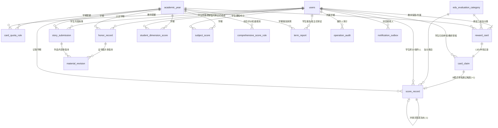
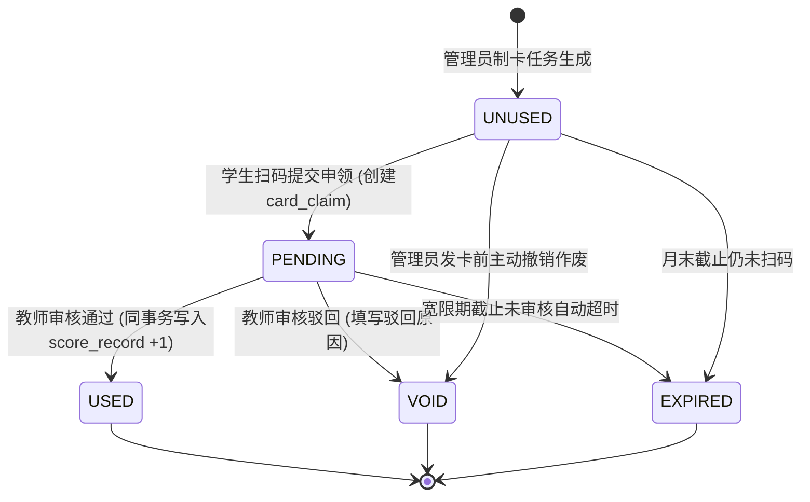

# 学生学期综合素质评价系统 - 数据库详细设计说明书

> **文档版本**：V1.2  
> **制定日期**：2026-10-22  
> **配套SQL脚本**：[sql/00_full_schema.sql](file:///Users/quanta/Downloads/task/六育学生评价系统v2/sql/00_full_schema.sql)  
> **数据库基准**：MySQL 8.0.16+ / InnoDB / utf8mb4 / utf8mb4_0900_ai_ci  
> **设计目标**：建立支持高并发防重、不可篡改流水、多版本留痕、轻量高效全生命周期闭环的 16 张核心业务表架构（已剔除冗余生命周期表、暂存导入表与申诉工单表，导入采用内存/临时处理并通过 `batch_no` 溯源）。

---

## 目录
1. [系统数据架构与ER关系模型](#一系统数据架构与er关系模型)
2. [数据表全景分类与索引清单](#二数据表全景分类与索引清单)
3. [核心业务表数据字典](#三核心业务表数据字典)
4. [核心状态机设计与转换流](#四核心状态机设计与转换流)
5. [高并发、一致性与事务边界伪代码](#五高并发一致性与事务边界伪代码)
6. [安全性、脱敏与归档约束](#六安全性脱敏与归档约束)

---

## 一、系统数据架构与ER关系模型

系统划分六大核心数据域：
1. **主数据与学期基础域**：`academic_year`, `users`, `edu_evaluation_category`
2. **评价卡与积分流水域**：`card_quota_rule`, `reward_card`, `card_claim`, `score_record`
3. **荣誉、故事与材料域**：`honor_record`, `story_submission`, `material_revision`
4. **外部成绩与学科课程域**：`student_dimension_score`, `subject_score`
5. **规则与期末报告域**：`comprehensive_score_rule`, `term_report`
6. **治理、运维与消息域**：`operation_audit`, `notification_outbox`

### 实体关系图 (Mermaid ER)



---

## 二、数据表全景分类与索引清单

| 序号 | 表名 | 表中文名 | 核心主键与唯一约束 | 关键业务索引 |
| :---: | :--- | :--- | :--- | :--- |
| **1** | `academic_year` | 学年学期字典表 | `PRIMARY(id)`, `uk_school_year_semester(academic_year, semester)` | `(school_id, is_current, active)` |
| **2** | `users` | 用户基础表 | `PRIMARY(id)`, `uk_user_school_username(school_id, username)` | `(school_id, role, status)`, `(grade, class_no)` |
| **3** | `edu_evaluation_category` | 六育三级指标分类表 | `PRIMARY(id)`, `uk_category_code_version(category_code, version)` | `(parent_id)`, `(category_level, status, sort_order)` |
| **4** | `card_quota_rule` | 教师月度配卡规则表 | `PRIMARY(id)`, `uk_quota_school_term_month_teacher(school_id, term_id, month_key, teacher_id)` | `(teacher_id, month_key)` |
| **5** | `reward_card` | 实体评价卡资产表 | `PRIMARY(id)`, `uk_card_token_hash(token_hash)`, `uk_card_month_serial(school_id, term_id, teacher_id, month_key, serial_no)` | `(teacher_id, month_key, status)`, `(used_student_id, status)` |
| **6** | `card_claim` | 学生扫卡申领记录表 | `PRIMARY(id)`, `uk_claim_card(card_id)`, `uk_claim_request_key(request_key)` | `(reviewer_id, status)`, `(student_id, status)` |
| **7** | `score_record` | 六育过程积分流水表 | `PRIMARY(id)`, `uk_score_request_key(request_key)`, `uk_score_card_claim(card_claim_id)`, `uk_score_reversal_original(original_id)` | `(student_id, term_id, dimension_code)`, `(term_id, source)` |
| **8** | `honor_record` | 学生荣誉申报认定表 | `PRIMARY(id)`, `uk_honor_event(student_id, term_id, event_key)` | `(reviewer_id, status)`, `(student_id, term_id, status)` |
| **9** | `story_submission` | 月度生活故事作品表 | `PRIMARY(id)`, `uk_story_student_term_month(school_id, student_id, term_id, month_key)` | `(reviewer_id, status)`, `(term_id, status)` |
| **10** | `material_revision` | 佐证材料多版本留痕表 | `PRIMARY(id)`, `uk_material_owner_version(owner_type, owner_id, version_no)` | `(created_by)`, `(content_hash)` |
| **11** | `student_dimension_score`| 六育正式百分制成绩表 | `PRIMARY(id)`, `uk_student_dim_score_version(school_id, student_id, term_id, dimension_code, version)` | `(term_id, dimension_code)`, `(batch_no)` |
| **12** | `subject_score` | 学科课程原始成绩表 | `PRIMARY(id)`, `uk_subject_score_version(student_id, term_id, subject_code, version)` | `(term_id, subject_code)`, `(batch_no)` |
| **13** | `comprehensive_score_rule`| 综合评价权重规则表 | `PRIMARY(id)`, `uk_comp_rule_version(school_id, term_id, rule_version)` | `(term_id, rule_status)` |
| **14** | `term_report` | 学期综合素质报告表 | `PRIMARY(id)`, `uk_term_report_version(school_id, student_id, term_id, version)` | `(student_id, status)`, `(term_id, status)` |
| **15** | `operation_audit` | 系统操作审计日志表 | `PRIMARY(id)` | `(actor_user_id, created_at)`, `(target_type, target_id)`, `(request_id)` |
| **16** | `notification_outbox` | 消息通知可靠外发箱表 | `PRIMARY(id)`, `uk_outbox_business_key(recipient_id, message_type, business_key)` | `(state, scheduled_at)` |

---

## 三、核心业务表数据字典

### 1. `reward_card`（实体评价卡资产表）
* **定位**：每月由管理员指令或任务批量生成的实体卡条目。卡片在生成时绑定教师ID作为归属责任人，不预先绑定学生。
* **业务不变量**：
  * 每张卡必须具有不可预测的 `token_hash`，印刷二维码仅包含随机令牌，不包含卡号或学生个人信息。
  * `serial_no` 在 `(school_id, term_id, teacher_id, month_key)` 范围内单调递增，便于纸质卡盘点对账。
  * `status` 从 `UNUSED` 变为 `PENDING`，审批通过后置为 `USED` 终态。任何被作废或超期的卡不可复活。

### 2. `card_claim`（学生扫卡申领记录表）
* **定位**：学生扫码后创建的待审批业务单据。B模式下积分生效的唯一前置凭证。
* **业务不变量**：
  * `uk_claim_card` 唯一约束保证**一张实体卡有且仅有一条有效申领链**。
  * `request_key` 保证同一学生多次点击或网络重试幂等返回同一申请。
  * 审核状态变为 `APPROVED` 或 `REJECTED` 时，必须同时记录审核教师及时间。

### 3. `score_record`（六育过程积分流水表）
* **定位**：金融级不可篡改积分总账。
* **业务不变量**：
  * `delta` 严格限制为 `+1`（正常奖励）或 `-1`（授权纠错冲销）。
  * 冲销时必须填写 `original_id`，且通过 `uk_score_reversal_original` 唯一约束保证**一笔原始+1奖励最多只能被冲销一次**。
  * 严禁 `UPDATE` 或 `DELETE` 历史行。学生总分一律为 `SUM(delta)` 聚合运算。
  * B模式入账时必须通过 `card_claim_id` 关联申领单，`uk_score_card_claim` 约束杜绝单据二次发分。

### 4. `honor_record`（学生荣誉申报与认定表）
* **定位**：记录竞赛与综合表彰成果。
* **业务不变量**：
  * `honor_points` 采用 MySQL 8.0 `STORED` 计算列，严格匹配规则：省级（一等9、二等8、三等7）、市级（一等6、二等5、三等4）、区级（一等3、二等2、三等1）。
  * `event_key` 稳定去重键确保同一学生在同一比赛届次中仅能认定最高等级奖项，不发生重复发分。

### 5. `term_report`（学生学期综合素质发展报告表）
* **定位**：期末向学生定向发布的综合报告载体。
* **业务不变量**：
  * `snapshot_json` 封存生成报告时刻的全量数据快照（包含六育各分项、A/B明细、荣誉清单、学科成绩与班级快照）。
  * 报告一经进入 `PUBLISHED` 状态，对学生只读。发生更正时必须生成 `version + 1` 的新报告，旧版标记为 `SUPERSEDED`。

---

## 四、核心状态机设计与转换流

### 实体评价卡生命周期 (reward_card.status)



---

## 五、高并发、一致性与事务边界伪代码

### 1. B模式扫码审核通过并入账原子事务

```sql
-- 场景：教师在前端点击“通过”学生提交的扫码申领 (claimId=501001, teacherId=2001)
START TRANSACTION;

-- 1. 检查学期是否有效且当前仍在有效期内
SELECT id, is_current, active, start_date, end_date 
FROM academic_year 
WHERE id = 1 AND active = 1 FOR SHARE;
-- 若学期已停用或已过有效日期，则 ROLLBACK (错误码: TERM_CLOSED);

-- 2. 悲观行锁锁定申领记录，严格校验状态为 PENDING
SELECT id, card_id, student_id, status 
FROM card_claim 
WHERE id = 501001 FOR UPDATE;
-- 若 status <> 'PENDING' 则 ROLLBACK (错误码: CLAIM_NOT_PENDING);

-- 3. 悲观行锁锁定实体卡，校验归属教师与状态
SELECT id, teacher_id, category_id, status 
FROM reward_card 
WHERE id = @claim_card_id FOR UPDATE;
-- 若 status <> 'PENDING' OR teacher_id <> 2001 则 ROLLBACK (错误码: FORBIDDEN_SCOPE);

-- 4. 更新申领单为已通过
UPDATE card_claim 
SET status = 'APPROVED', reviewer_id = 2001, reviewed_at = NOW(6)
WHERE id = 501001;

-- 5. 更新实体卡为已入账永久终态
UPDATE reward_card 
SET status = 'USED', used_student_id = @claim_student_id, used_at = NOW(6)
WHERE id = @claim_card_id;

-- 6. 向积分账追加一笔不可逆的正向流水 (+1)
INSERT INTO score_record (
  school_id, term_id, student_id, class_snapshot, dimension_code, 
  category_id, source, delta, card_claim_id, operator_id, request_key, created_at
) VALUES (
  1, 1, @claim_student_id, '{"grade":4,"class_no":1}', 'D', 
  @card_category_id, 'B_CARD', 1, 501001, 2001, 'REQ_CLAIM_APPROVE_501001', NOW(6)
);

-- 7. 写入消息外发箱，异步通知学生
INSERT INTO notification_outbox (
  school_id, recipient_id, message_type, business_key, payload_json, state
) VALUES (
  1, @claim_student_id, 'CLAIM_RESULT', 'CLAIM_501001', 
  '{"title":"评价卡审核通过","delta":1,"message":"德育+1分已入账"}', 'PENDING'
);

-- 8. 写入安全审计日志
INSERT INTO operation_audit (
  school_id, actor_user_id, actor_role, target_type, target_id, action, request_id
) VALUES (
  1, 2001, 'teacher', 'CARD_CLAIM', 501001, 'CLAIM_APPROVE', 'REQ_CLAIM_APPROVE_501001'
);

COMMIT;
```

### 2. A模式教师批量无卡直评幂等写入事务

```sql
-- 场景：教师批量为 3 名学生直评文明礼仪 (+1分)
START TRANSACTION;

-- 校验教师对所选学生的任教授权...
-- 对每个学生执行原子插入：
INSERT INTO score_record (
  school_id, term_id, student_id, class_snapshot, dimension_code,
  category_id, source, delta, card_claim_id, operator_id, request_key, remark
) VALUES (
  1, 1, 101, '{"grade":4,"class_no":1}', 'D',
  15, 'A_DIRECT', 1, NULL, 2001, 'BATCH_REQ_20261022_101', '课堂主动发言表扬'
);
-- 重复提交由 UNIQUE KEY uk_score_request_key 拦截并抛出 DUPLICATE_REQUEST，避免多次加分。

COMMIT;
```

### 3. 授权更正与冲销流水原子事务

```sql
-- 场景：管理员核实发现误发积分，授权执行冲销流水原子事务 (原score_record_id=9001)
START TRANSACTION;

-- 1. 锁定原流水
SELECT id, student_id, term_id, dimension_code, category_id, delta 
FROM score_record 
WHERE id = 9001 FOR UPDATE;

-- 2. 插入冲销流水 (-1分)
INSERT INTO score_record (
  school_id, term_id, student_id, class_snapshot, dimension_code,
  category_id, source, delta, card_claim_id, original_id, operator_id, request_key, remark
) VALUES (
  1, @term_id, @student_id, '{"grade":4,"class_no":1}', @dimension_code,
  @category_id, 'REVERSAL', -1, NULL, 9001, 3001, 'REQ_REVERSAL_9001', '管理核准冲销错发积分'
);
-- uk_score_reversal_original 确保 original_id 唯一，防止重复扣减！

-- 3. 记录高危冲销操作全量审计
INSERT INTO operation_audit (
  school_id, actor_user_id, actor_role, target_type, target_id, action, request_id,
  old_summary, new_summary
) VALUES (
  1, 3001, 'manager', 'SCORE_RECORD', 9001, 'SCORE_REVERSAL', 'REQ_REVERSAL_9001',
  JSON_OBJECT('original_id', 9001, 'delta', 1), JSON_OBJECT('reversal_id', LAST_INSERT_ID(), 'delta', -1)
);

COMMIT;
```

---

## 六、安全性、脱敏与归档约束

1. **未成年人隐私脱敏**：
   - 生产数据库中 `users.password` 必须以散列密文存储，严禁明文暴露；
   - 生产日志中严禁打印完整的姓名、证件号、手机号及二维码明文 Token；
   - 实体卡仅保存不可逆的 `token_hash`，印刷完成后不留存明文二维码映射表。
2. **多租户与跨校隔离**：
   - 所有业务表除 `academic_year` 全局字典外，强制包含 `school_id` 字段；
   - 所有后台查询与更新接口在 SQL 层面强制附加 `WHERE school_id = :currentUserSchoolId`。
3. **学期归档快照与数据只读保护**：
   - 当学期处于非活动状态（`academic_year.active = 0` 或已超过归档结算截止期）时，应用层网关拒绝所有针对该学期 `score_record`, `card_claim`, `honor_record`, `term_report` 的新建与修改请求；
   - 学期归档后全局置为只读，若确有历史数据异常需修正，由系统管理员经授权后发起版本更正与冲销流水，并记入 `operation_audit` 全量审计。
