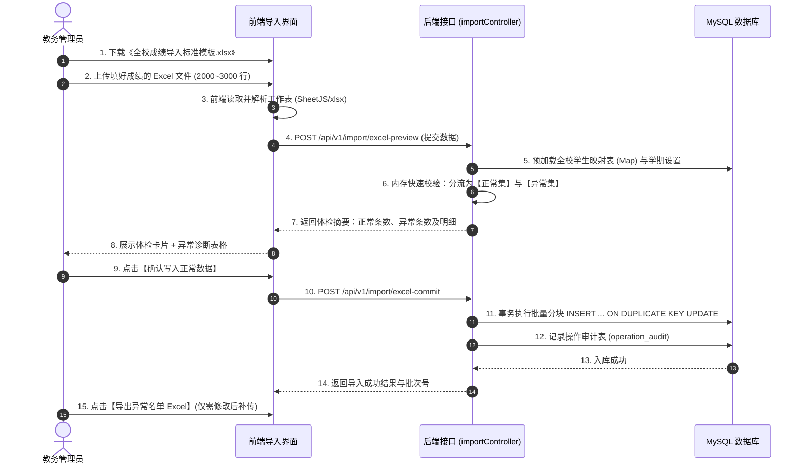

# 架构与功能设计方案：全校学生成绩 Excel 批量导入系统

- **文档标识**：`docs/superpowers/specs/2026-10-26-excel-score-batch-import-design.md`
- **创建日期**：2026-10-26
- **设计状态**：已评审待执行

---

## 1. 背景与业务动机 (Intent & Why)

### 1.1 现状痛点
在现有系统中，期末成绩/六育终测成绩导入界面采用手工粘贴 JSON 数组（`SAMPLE_SUBJECT_RECORDS`）的模式，且单次限制 ≤ 1000 条。
在全校实际教学业务中：
1. **数据量大**：全校通常有 2,000 ~ 3,000 名在读学生，每生包含 6 ~ 10 门科目，总分值记录数达 15,000 ~ 30,000 条。人工转换或粘贴 JSON 根本不具备可行性。
2. **数据源现状**：教务处每次统考后整理的原始文件均为 Excel 工作表（`.xlsx` / `.xls`），需要系统直接支持全科汇总大表的“开箱即用”导入。
3. **容错诉求**：数千行数据中偶有学号打错、个别学科缺考或格式偏差。若实行“全表全阻断（All-or-Nothing）”，教务人员将陷入反复重传的低效循环；必须支持“正常数据先行入库，异常数据精准剔除并支持导出”。

---

## 2. 目标、非目标与反目标 (Goals, Non-Goals & Anti-Goals)

### 2.1 目标 (Goals)
1. **Excel 大总表原生支持**：
   - 支持教务处上传涵盖全校 2,000 ~ 3,000 人的单张 Excel 大总表。
   - 提供标准模板下载（含表头及示例行），支持学生信息（学号、姓名、班级）与横向多学科（语文、数学、英语等）的一行式录入。
2. **分流容错与部分入库**：
   - 校验通过的正常学生成绩全部入库。
   - 存在异常的行被自动拦截并诊断，前端直接展示异常明细。
   - 提供【导出异常名单 Excel】功能，保留原数据并附带诊断原因，修改后支持单独补传。
3. **高性能与大吞吐处理**：
   - 后端由单条循环 `await conn.query` 重构成批量多行 `INSERT ... VALUES (...) ON DUPLICATE KEY UPDATE`，单批次处理 2,000~3,000 名学生（约 2 万条分值）入库耗时控制在 2 秒以内。
4. **审计跟踪与防重复**：
   - 自动生成批次号 `batch_no`，记录入库人、入库总数与耗时。
   - 同一学期同一科目的重复导入默认覆盖更新（UPSERT），保证成绩唯一性。

### 2.2 非目标 (Non-Goals)
- 本次不引入复杂的分布式任务队列（如 Redis/BullMQ），利用 Node.js 内存解析 + 批量 SQL 即可在秒级完成 3000 行 Excel 的处理，避免引入额外基础设施依赖。
- 不提供跨年级不同科目集的动态列公式计算（Excel 负责记录最终得分，折算及雷达图由现有系统算法引擎自动计算）。

### 2.3 反目标 (Anti-Goals)
- **坚决禁止阻断式全局报错**：绝不允许因为第 1500 行的某个数字格式错误，导致前面 1499 名和后面 1500 名学生的正常数据全部失败。
- **坚决禁止浏览器主线程假死**：前端在解析 3000 行 Excel 时需优化内存，提供平滑加载状态与进度提示。

---

## 3. Excel 表格结构与规范 (Data Schema)

### 3.1 全科成绩总表格式规范

| 列序号 | 列名（中英文自适应） | 必填 | 说明 | 示例 |
| :--- | :--- | :--- | :--- | :--- |
| A | 学号 / 账号 (username / student_no) | **是** | 学生唯一标识，用于匹配 `users` 表 | `202401001` |
| B | 姓名 (real_name) | 否 | 辅助核验（若与学号不匹配仅告警或以学号为准） | `张小明` |
| C | 年级 (grade) | 否 | 辅助筛选分类 | `初一` 或 `7` |
| D | 班级 (class_no) | 否 | 辅助筛选分类 | `1班` 或 `1` |
| E | 语文 (chinese) | 否 | 分值（0~100 或对应满分），留空表示缺考 | `92.5` |
| F | 数学 (math) | 否 | 分值，留空表示缺考 | `98` |
| G | 英语 (english) | 否 | 分值，留空表示缺考 | `89.5` |
| H~ | 物理 / 化学 / 政治 / 历史 / 生物 / 地理 / 体育 等 | 否 | 后续学科列自适应扩展 | `90` |

> **注**：对于“六育终测维度评分”导入，模板提供对应的维度大表：学号、姓名、德育(D)、智育(Z)、体育(T)、美育(M)、劳育(L)、生活故事(G)。

---

## 4. 详细流程与交互设计 (Interaction & Flow)



### 4.1 前端交互细节
1. **替换原 JSON 录入区**：
   - 移除原有 `<TextArea>` JSON 粘贴框。
   - 新增 `<Upload.Dragger>` 支持拖拽和点击选择本地 Excel 文件（限制 `.xlsx`, `.xls`）。
2. **下载标准模板**：
   - 顶部工具栏提供【下载学科成绩导入模板】与【下载六育维度导入模板】按钮，自动触发预制标准 Excel 文件下载。
3. **体检预览卡片**：
   - 文件上传后，展示统计卡片：
     - **正常待入库学生**：绿色高亮，如 `2,982 人 (99.4%)`
     - **异常阻断学生**：红色高亮，如 `18 人 (0.6%)`
     - **覆盖科目**：展示检测到的学科列（如 `9 门`）
4. **异常明细表与导出**：
   - 底部表格展示异常行的行号、输入学号、姓名、错误原因。
   - 点击【导出异常数据 (Excel)】，调用客户端导出生成带有“错误诊断”列的 Excel，方便教务老师转交班主任核实。
5. **确认入库**：
   - 具备一键【确认入库正常数据】按钮，带 Loading 状态；入库完成后自动刷新结果。

---

## 5. 后端架构与高性能改造 (Backend Technical Design)

### 5.1 批处理 SQL 性能优化
原 `commitImport` 采用串行单条 SQL 查询与写入：
```js
// 旧实现缺陷：2500 学生 * 8 门科目 = 20,000 次数据库网络往返，耗时往往超 30 秒
for (const item of items) {
  await conn.query(`INSERT INTO subject_score ...`);
}
```
**改造为分批多值 INSERT（Chunked Bulk Upsert）**：
- 将正常数据按 1,000 条/批分块。
- 每块拼装为一条单一 SQL：
  ```sql
  INSERT INTO subject_score (
    school_id, term_id, student_id, subject_code, subject_name, raw_score, full_score, batch_no
  ) VALUES 
    (1, 2, 101, 'CHINESE', '语文', 95.0, 100.0, 'IMP_001'),
    (1, 2, 101, 'MATH',    '数学', 98.0, 100.0, 'IMP_001'),
    ... -- 1000 行
  ON DUPLICATE KEY UPDATE
    raw_score = VALUES(raw_score),
    batch_no = VALUES(batch_no);
  ```
- 20,000 条记录仅需 20 次数据库通信，在本地或同内网 MySQL 环境下 **1.2 秒内即可全部入库**。

### 5.2 接口定义

#### 1) `POST /api/v1/import/excel-preview`
- **入参**：
  ```json
  {
    "type": "SUBJECT",
    "termId": 1,
    "rows": [
      { "rowNum": 2, "username": "20240101", "realName": "张三", "scores": { "CHINESE": 90, "MATH": 95 } }
    ]
  }
  ```
- **出参**：
  ```json
  {
    "code": 200,
    "data": {
      "totalStudents": 2500,
      "validCount": 2485,
      "invalidCount": 15,
      "errors": [
        { "rowNum": 142, "username": "20240999", "realName": "李四", "reason": "学号在系统学生库中不存在" }
      ],
      "subjectsDetected": ["CHINESE", "MATH", "ENGLISH"]
    }
  }
  ```

#### 2) `POST /api/v1/import/excel-commit`
- **入参**：
  ```json
  {
    "type": "SUBJECT",
    "termId": 1,
    "validRows": [ ... ]
  }
  ```
- **出参**：
  ```json
  {
    "code": 200,
    "data": {
      "batchNo": "IMP_20261026_A8F1",
      "committedStudents": 2485,
      "committedScoresCount": 19880
    },
    "message": "全校成绩批量导入成功"
  }
  ```

---

## 6. 验证与测试标准 (Verification Criteria)

1. **功能完整性验证**：
   - 生成一份含 2,500 名学生的模拟全校成绩 Excel 表，混入 10 行错误数据（如空学号、不存在学号、负数分值、超 100 分值）。
   - 上传后，预览界面准确识别出 2,490 名正常学生与 10 名异常学生。
   - 确认入库后，`subject_score` 表新增或更新 2,490 对应的各科分数，未受 10 名错误学生影响。
   - 导出异常数据 Excel，导出的文件包含该 10 名学生的原始信息及具体错误原因。
2. **性能压测验证**：
   - 针对 3,000 名学生、8 门学科（共 24,000 记录）的导入包，后端批量写入耗时 ≤ 3 秒。
3. **回归与权限验证**：
   - 教师角色无法导入六育终测（DIMENSION），教务管理员角色具备全部导入权限。
