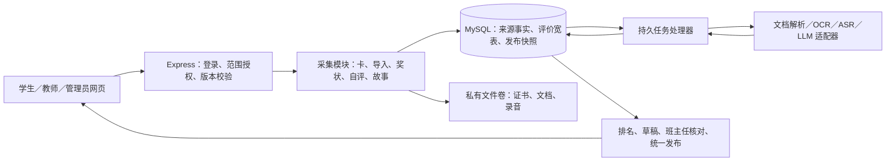

# 学生综合素质评价（六育）系统整体改版设计

日期：2026-10-30。版本：SIX_EDU_V2。交付范围：可据此实施的最终设计、数据库变更和迁移方案、验收标准。本次未修改产品代码、未连接或迁移生产数据库，未调用付费模型。

## 1. 设计结论与依据

采用**现有 React 18／Vite + Express + MySQL 8 的模块化单体，复用六张核心表，只新增一张故事内容表**。所有评分先形成可追溯的来源记录，再计算学生学期结果；班主任核对，管理员统一发布冻结报告。模型负责提取和辅助评价，数据库约束与业务规则决定最终入账。

本方案依据本次用户文字、附图 `/Users/quanta/Downloads/chart.png`，以及仓库实际入口、DDL、服务代码。文字与图片冲突时以本次文字为准；历史文档中的其他需求不自动延续。本次只核对了代码和仓库 DDL，不能据此证明部署库当前结构、真实模型能力或生产运行情况。

### 1.1 当前实现与本次变更

| 已核对的仓库事实 | 本次处理 |
| --- | --- |
| `README.md`、`backend/app.js` 为新版报告核心入口；`sql/05_term_report_core_schema.sql` 定义六张核心表 | 沿用该基线；旧 `00_full_schema.sql` 等不是本次在线升级脚本 |
| `reportCorePolicy.js` 按固定目标分折星 | 改为班内同项目卡分排名折星 |
| `reportCoreStories.js` 为每月读／听／讲各 1–3 篇文本 | 新版改成内置故事播放、写作上传、实际录音三条独立流程，移除月批次对新版的约束 |
| `reportCorePolicy.json` 的旧卡目录有 37 项，且劳美不发卡 | 新版只向过程表现发卡，采用第 4 节的 14 个目标；劳美支持发卡和直评 |
| 原字段将学习兴趣、习惯、方法、体测水平、部分音美教师评价映射为 CARD | 新版这些格子由外部导入提供，避免卡数冒充教师评价或体测结果 |
| 原报告为其他学校 PDF 的 109 个位置；信息科技位于劳美 | 本版按本次图片重做映射，信息科技属于智美；不沿用旧展示格数 |
| 已有来源幂等、任务租约、报告确认及全校发布框架 | 复用机制，调整字段与权限白名单；不把旧测试通过等同于新版验收 |

核查文件：`backend/services/reportCore{Policy,Projection,Stories,Materials,Imports,Provider,Worker,Publish,Store}.js`、`authorizationService.js`、`deploy/report-core-cutover.md`。

### 1.2 本版明确采用的默认值

以下为设计者裁定，可在学校启用前调整并冻结版本，不声称学校已确认：

1. 六育为德美、智美、健美、艺美、劳美、故事美；故事是独立第六板块。数据入口仍为用户指定的五种，直评与扫码共用“卡生成”。寄语属于教师业务，不另算第六种入口。
2. 星级为 1–3 星，字母等级默认 A／B／C／D；未采集显示“—”，不适用显示“不适用”，真实零分保留 0。
3. 过程表现按同班、同学期、同目标排名：前 20% 三星，随后 40% 两星，其余一星；并列共享名次和星级，零分一星。精确边界见第 5 节。
4. 荣誉五级为校级、区／县级、市级、省级、国家级，积分依次 1／2／3／4／5；国际、机构自称级别等不能自动归入国家级，交人工认定。
5. 听故事按有效完成的不同内置故事数量排名；写故事按有效不同作品数量排名；讲故事按有效作品的最高分排名。听、写、讲互不混加。
6. 原图“我爱读故事”改为“我爱写故事”，与本次需求一致；不额外开发第四条读故事流程。
7. 荣誉区仅展示“荣誉名称、级别”两列。一等奖等保留在后台证据中，不能因图片示例有第三列就扩展正式展示字段。
8. 德美八项教师评价来自导入；德育卡汇总另在德美标题右侧显示“过程表现”，不覆盖八项他评。这是一处有意的版式补充，使德育卡有明确报表落点。
9. 默认单校 5,000 名学生、并发在线 200 人；部署采用一套应用、一个任务进程、一个 MySQL 主库和持久私有文件卷。性能目标须实测，不作为已有能力承诺。

不引入微服务、Kafka、Redis、积分商城、家长独立账号、跨校总榜或六育混合总分。各维度的原始分、教师等级、故事分具有不同含义，不相加制造一个“综合分”。

## 2. 系统架构与模块



| 模块 | 负责的业务与边界 |
| --- | --- |
| 身份与学籍 | 登录、学校隔离、学期学生名单、任教与班主任关系、停用和会话撤销 |
| 卡与过程评价 | 14 个过程目标、教师额度、批量制卡、打印导出、扫码和直评、撤销与追溯 |
| 综合成绩导入 | 模板、服务端解析、身份及数据校验、差异预览、提交与更正 |
| 自评 | 八项行为及体测、音乐、美术共 11 项；草稿、提交、截止控制 |
| 奖状与荣誉 | 文件、识别、教师审核、五级积分、去重、撤销和展示 |
| 故事活动 | 100 个内置故事、播放完成验证、写作上传、录音识别评分、三榜 |
| 故事库与荣誉墙 | 优秀作品提名、教师审核、展示授权、校内发布、撤下 |
| 统计与报告 | 卡分排名折星、六板块映射、寄语草稿、确认、发布快照及打印 |
| 任务与运行维护 | 持久队列、租约重试、失败复核、审计、备份与恢复 |

同一数据库中的短事务维护一致性。文件先落盘且校验成功，再提交来源引用；文件与数据库不能组成一个 ACID 事务，通过上传暂存、确认、孤立文件清理补偿。模型或转码调用放在事务外，不能持锁等待外部服务。

前端提供学生移动页面、教师工作台、管理员配置／发布台；共用登录与权限接口。教师批量操作、文件解析和导出使用后台任务，不靠浏览器一直开着才能完成。

## 3. 角色与权限

数据库继续使用 `student / teacher / manager` 三种角色；班主任和故事编辑是教师的职责，不增设账号体系。

| 能力 | 学生 | 任课教师 | 班主任 | 管理员 |
| --- | --- | --- | --- | --- |
| 自评、奖状、写作、录音、扫码 | 仅本人 | 查阅授权项目证据 | 查阅本班，处理异常 | 看任务数量与错误码，不默认读原始私有材料 |
| 无卡直评、制卡 | 无 | 所任班级及所教学科目标；德美目标允许本班任课教师 | 本班德美及已授权目标 | 配额与授权管理，不能冒名代评 |
| 综合 Excel 导入 | 无 | 自己任教字段 | 可导入本班所有学科与八项行为教师评价，记录数据提供教师 | 体测原值、名单及受控代导；代导记录原因和来源人 |
| 审核奖状 | 查本人状态、申请复核 | 本学科证书，可转班主任 | 本班全部证书及争议 | 指派审核职责、看进度 |
| 讲故事人工复核 | 本人申诉 | 被指派的本班故事教师 | 本班兜底复核 | 指派，不直接篡改成绩 |
| 经典故事审核 | 本人授权／撤销展示 | 被指派的故事编辑 | 提名本班作品 | 发布校内故事库和期末墙的审核通过内容 |
| 六育报表 | 本人已发布报告 | 任教班级的学科明细与获授权汇总 | 本班完整草稿、寄语及确认 | 完成率、发布清单和校级脱敏汇总 |
| 学期配置／全校发布 | 无 | 无 | 核对确认 | 有 |

具体规则：

- 角色、学校从服务端会话获取；`school_id`、学生归属、目标学科和当前任教关系逐次核验，不能信任请求里的教师／班级字段。
- 学生身份用不可变 `users.id`；Excel 默认用同校唯一账号／学号 `username` 定位，姓名只用于交叉核对，不按同名匹配。另有学籍号时先建立经核验的唯一映射。
- 权限变更立即生效；停用账号或提升 `token_version` 使旧登录失效。批量导出和下载同样鉴权，下载凭据短时有效。
- 任课教师默认不能查看全班自述、完整健康档案或其他学科原材料；体育／班主任按职责读取健康数据。审核人只读取其待办需要的证据。
- 榜单限本校登录用户访问，默认显示姓名脱敏、班级、指标值与名次；本人可见自己的完整信息。不向全校公开健康数据、证书原图和学生录音。
- 教师可兼任学生监护人等现实身份不推导为权限；自评由学生账号提交，班主任不能代填成“学生已评价”。

## 4. 五种来源与核心业务闭环

### 4.1 卡生成：制卡、扫码和无卡直评

卡的 14 个目标固定为：德美综合 1 项；智美六科过程 6 项；体育与健康过程、体测过程 2 项；音乐、美术过程 2 项；劳动、综合实践、地方课程过程 3 项。每条卡／直评只指向一个目标。

稳定编码示例：`MORAL_PROCESS`、`CHINESE_PROCESS`、`INFORMATION_TECHNOLOGY_PROCESS`、`FITNESS_PROCESS`、`LABOR_PROCESS`。德美综合和智美“道德与法治过程”是两个不同目标。

**制卡：**管理员按学期、月份、教师设置总额度；教师选择获授权的班级与目标分配数量，系统按任课关系预填，生成独立随机凭证。可一次生成多个班级，按班导出 PDF，再打 ZIP；重印引用原卡，不生成新凭证、不再次扣额度。

额度满足：`已生成实体卡数 ≤ 管理员批准额度`。并发制卡锁定对应额度记录；一张已生成卡占一个额度，过期或作废不自动返还；管理员追加额度有原因及审计。无卡直评不消耗实体卡额度，单独统计教师直评频次，异常批量评分可追溯，不自动当作弊扣分。

卡绑定学校、学期、月份、发行教师、发行班级、目标、有效期，固定 `+1`。二维码只含高熵随机凭证和领取地址，不放姓名、裸学生 ID 或可修改的积分。数据库保存凭证摘要；为授权重印保留加密凭证，解密密钥独立备份。

**扫码：**学生登录后提交凭证 → 校验有效期、学期、班级、卡状态 → 同一短事务锁卡并校验来源业务键 → `UNUSED → USED`、绑定本人、积分入账。成功响应丢失后同一学生重试返回原成功结果；其他学生领取返回已使用，不能产生第二分。二维码 GET 打开页面不直接领分，领取为鉴权 POST。

卡有效期取月份、学期、采集截止的交集；服务器时间为准。过期、作废、异校异班、未登录均给出明确状态；临时断网显示“未确认”，恢复后用同一请求键查询／重试，客户端不得先写成功积分。

**直评：**教师选班级、多名学生和一个获授权目标，填事实说明，给每人 `+1`；不提供任意分数框。一个批次最多 100 人，整批事务成功或失败。每个学生产生独立来源明细，批次有唯一操作号；重复提交不重复加分，有意再次评价必须为新操作。

**撤销：**发行／评价教师可更正自己在任教范围内的错误；离职、范围变更后由班主任在本班有理由地更正。新增 `REVERSAL -1` 指向原记录，不删除原账。`原记录最多一个有效冲正` 由现有唯一约束保证。被撤销的卡保持 USED，不能重新领取；原 `+1` 和冲正 `-1` 一并参与求和，不能先排除原记录后再减 1。学期冻结时进入更正流程，不直接改已发布报告。

### 4.2 外部导入：综合成绩与体测

模板由服务端按学期、年级、字段版本生成，包含学期标识、学生唯一账号、姓名、班级、数据提供教师及以下列组：

| 列组 | 接收字段 | 正式值类型 |
| --- | --- | --- |
| 德美 | 有礼貌、讲信用、有爱心、善交流、讲文明、负责任、守规则、会合作的教师评价 | 1–3 星；本次输入清单漏写“会合作”，模板补齐 |
| 智美六科 | 道德与法治、语文、数学、科学、英语、信息科技，每科兴趣、习惯、方法 | 1–3 星，共 18 项 |
| 智美学业 | 上述六科每科平时、期末、总评 | A／B／C／D，共 18 项 |
| 健康原值 | 身高 cm、体重 kg、视力左、视力右、1 分钟跳绳次数、测量日期、视力制式 | 数值及元数据 |
| 体育 | 体育与健康学业水平、体测水平 | 学业 A–D；体测 1–3 星 |
| 艺美 | 音乐、美术教师评价；学业平时、总评 | 教师评价 1–3 星；学业 A–D |
| 劳美 | 劳动、综合实践活动、地方课程学科素养水平 | A／B／C／D |

只收本模板约定的等级；如学校提供分数或“优秀／良好”等，先配置可追溯映射再转换，不猜阈值。平时、期末、总评均由教师提供，默认不对字母求平均，也不擅自按 40%／60%计算总评。

最简可靠流程：上传 Excel → 后端独立解析校验 → 显示新旧值、错误单元格及行列坐标 → 操作者确认 → 再次核验权限、配置版本、名单版本及受影响行 revision → 整批提交 → 返回计数及下载回执。前端解析只作预览，服务端结果权威。

默认每批最多 500 名学生、10 MB。大文件先提示按班拆分，避免“全校一个大事务”。同一学生同一字段重复行、错误学期、身份不符、未知表头、非法值、公式、宏或超额文件，阻断本批，不静默丢行或只导入部分成功。

空单元格默认“不修改”，清空必须选择专门的清空操作并预览影响；数值 0 是值。批次预览后他人改过相关数据，提交返回 409 并保留上传文件，重新预览，不以后提交者覆盖旧预览。

每次确认导入生成新来源版本；当前字段读取最新已确认且未撤销版本。回滚某批仅在该字段的当前来源仍是该批时直接恢复前版；已有后续更正时列出冲突，生成新的补偿批次，不恢复整行历史覆盖后续改动。

健康值必须保留测量日期、单位、视力制式。仅在同一测量组有合法身高和体重时计算 `BMI=kg/(cm/100)^2`，显示两位小数；例如 141 cm、35 kg 得 17.60。BMI 是附加原值，不自行给出肥胖等判断，也不参与卡分。5.0 与 1.0 制式不可混记或直接比较；缺少制式进入待复核。

### 4.3 奖状生成与荣誉

学生上传 JPG／PNG／PDF（单文件不超过 10 MB、PDF 不超过 10 页）→ 私有保存 → OCR／视觉模型提取名称、姓名、主办／颁发单位、日期、行政级别、奖次、证书编号 → 教师核验证据并确认五级 → 规则计算积分 → 报表只映射名称和级别。

模型不直接授予正式积分。即使识别成功，所有证书均需教师确认；无法识别时保留文件，学生可补填，教师可人工认定。姓名不符、日期跨学期、级别不明、疑似重复进入待复核，不默认通过或记零分。

有效证书按 `school + term + student + 规范化证书身份` 唯一：有证书编号优先使用编号和颁发单位；无编号使用名称、日期、颁发单位、奖次组合。相同文件摘要先拦截，同一赛事多张不同奖状由教师判定是否独立奖项；图像相似度仅提示，不自动判作弊。同一证书换图重传不能再得分。

积分 `honor_points = Σ 已批准且未撤销的独立证书级别分`，仅用于荣誉统计；不计入过程卡分和故事榜。级别和奖次是两件事，一等奖不自动等于国家级；奖次不乘倍数。

审核通过后学生申请更正／撤回，教师确认后撤销正式效果；保留原证据和审计，重算荣誉总分、报表列表及寄语事实。无证书是合法空列表，不阻断报告；待审核证书必须在结算时处理或由班主任明确排除并写原因，不默默按“无获奖”处理。

### 4.4 自我评价

八项行为 + 体质健康测试 + 音乐 + 美术，共 11 项，自评 1–3 星。学生可保存草稿，提交后至截止前可修改，保存新版本；教师评价、成绩导入、模型结果不能写这些列。

自评不产生卡分和校内竞赛分。无障碍协助仍由学生账号确认；确实无法完成的项目由班主任记录“免填原因”，显示“未填／免填”，不伪造星级。已冻结报告不随学生后续编辑改变。

### 4.5 故事生成：三条独立活动

#### A. 听故事

管理员导入带版权／使用来源说明的 100 个内置故事，包括稳定编号、文字、音频、时长、适用年级和内容摘要。启用学期时校验 100 项完整可播放；缺资源则不开放正式计分，可先以其余模块上线。内置内容修订产生版本，计数按稳定故事编号而非版本号去重。

打开播放由服务端建立会话，学生可暂停／续听；每 15 秒发送进度。服务端按接收时间间隔、播放状态及媒体区间累计有效时长和不重叠覆盖区间，不采用客户端报的总进度直接入账。两次心跳超过 30 秒的间隙不补算，快进的缺口不计覆盖，倍速计分播放默认限制为 1 倍；同学生同时只有一个有效计分播放会话。

完成条件为有效覆盖 ≥ 音频时长 95%、累计有效时长 ≥ 时长 95%，且播放到结尾或最后一个媒体分段。多个有效会话区间可合并；心跳缺失的合法收听可续听补足。通过后首次生成 `LISTEN_COMPLETE`：本学期该内置故事 `+1`，重复听不再加分，最多 100 分。再次播放仍可使用，不加分。

网页只能验证播放证据，无法证明本人始终专心；不宣称能完全杜绝代听。故障不能记已完成；给出已核验进度，恢复后继续。内置故事下架不撤销已经合法取得的完成记录；如原完成证据被确认伪造，教师走撤销并留原因。经典库作品可听，但不占这 100 项计分名额。

#### B. 写故事

支持直接输入和 TXT／DOC／DOCX／PDF 上传。文件 10 MB 内、PDF 50 页内；解析后的规范文本 100–20,000 个字符（空白不计入下限），长度不足可存草稿。数字和长度是初版接入限制，不是评分依据。

TXT 按 UTF-8 解码，失败时提示转码；DOC 在隔离转换器中转为可解析格式；DOCX 提取正文；PDF 优先文本提取、扫描页走 OCR。转换器无外网、限时、限内存，禁止宏执行和主动内容。提取失败保留原件，可重新上传或人工补录；补录的正式内容需与原件对照，不猜正文。

解析后学生必须预览和确认提交。相同学生同一学期的相同规范文本只算一篇；规范化包括 Unicode NFC、换行、连续空白及两端空白，标题改动不影响正文摘要。修订已有作品保留同一作品 ID、增加版本，仍计一篇。不同文本的近似重复进入复核；模型相似度不能单独定罪。

安全校验与内容审核通过后 `APPROVED` 计有效篇数；普通作品无需按模型分数决定是否计数。自动审核不可用时入教师待办，不默认通过。撤销则篇数减一并重算。排行榜衡量有效提交量，不声称衡量写作水平；优秀作品另按内容质量审核。

#### C. 讲故事

移动端页面提供大录音按钮，按住开始、松开停止，同时提供可访问的“开始／停止”模式、计时、试听、重录。默认单段 30 秒至 5 分钟，最多 20 MB；中断先保留本地临时录音并告知未提交。登录失效不丢当前草稿。

提交后流程为：私有音频落盘 → 实际格式／时长／静音检测 → 必要时统一转码 → ASR 转写 → LLM 按量规评分 → 结构校验 → 正式成绩。前端根据支持情况选择录音格式，不写死 WebM；服务端支持受控的 WebM／MP4-AAC／WAV 等实际探测格式。

麦克风需要 HTTPS 安全上下文，录制前探测能力并处理授权拒绝；这些是浏览器能力边界，见 [MDN getUserMedia](https://developer.mozilla.org/en-US/docs/Web/API/MediaDevices/getUserMedia) 和 [MediaRecorder.isTypeSupported](https://developer.mozilla.org/en-US/docs/Web/API/MediaRecorder/isTypeSupported_static)。不支持时允许上传现成录音作为降级入口；纯手写文本不能冒充录音成绩。

初版评分只评转写文本：内容完整性、条理结构、语言表达、主题理解，各 0–25 分，总分 0–100，保留两位小数。没有声学模型就不评价发音、情感、语速或流利度。ASR 文本与原音频均保留，学生只读转写；转写有错由教师听音复核，修订转写并重新评分，不能让学生编辑成另一篇文章。

模型必须返回四项分数、总分、证据片段、简短反馈、模型／量规版本；服务端重算合计、校验范围，证据须能在转写中定位。空白或全静音判无效；结构错误、置信度不可用且转写明显异常、内容风险等进入复核。正式有效零分仍是 0，服务失败是未评分，两者不同。

同一学生同学期相同原音频摘要不能重计，重复点击返回原任务；改元数据、换封装的疑似重复用标准化音频摘要辅助提示。语义相同但实际重录允许保留，仍按最高分排名，重复录音不会累加总分。最终人工分须使用同一量规、填依据、记录原模型分与复核分，不直接改排行榜。

### 4.6 优秀作品、校园经典故事库与期末荣誉墙

写／讲作品达到有效状态后可被学生申请或教师提名，系统也可推荐讲故事 ≥85 分作品；听完内置故事本身不产生学生原创作品。所有写作内容推荐均以人工质量审核为准，数量高不自动等于优秀。

流程：有效作品 → 提名 → 教师审核内容、权属和个人信息 → 获得展示授权 → 管理员发布至校内经典故事库 → 期末选择同一库中的作品发布荣誉墙。默认荣誉墙每班最多 3 件，由班主任推荐、学校审核；作品数量不足不硬凑，名额可在学期开始配置。

展示授权使用学校既有监护授权机制登记，未有明确展示授权时只允许私有评价。默认仅展示脱敏姓名、班级、标题、审核后的正文／音频；证书、健康及其他私有资料不得随作品带出。管理员只能发布已审核的展示副本，不能读取无关私有材料。

经典库与荣誉墙引用同一作品及内容版本，不二次加分。撤销展示授权、撤销原成绩／内容有效性时，立即撤下对应展示、失效下载权限，并记撤下原因。展示撤回本身不撤销原活动成绩；内容被认定无效才重算。报告中的合法历史成绩按原发布版本保留；后续纠错按新版本处理。

## 5. 评分、排名和星级算法

### 5.1 过程积分

对学生 s、学期 t、过程目标 k：

`P(s,t,k) = 有效已使用卡数 + 已确认直评次数 − 有效冲正次数`。

每张卡／每次直评均为 1 分；13 张卡即 13 分，超过星级阈值仍保留全部积分。未使用卡不计、导入成绩不计、奖状和故事不计。只要正常账完整，积分不能为负；若出现负数应阻断结算并展示异常来源，不静默截断成零。

同方向多个科目的分可在教师分析页求方向合计，但报表每个过程格按其明确目标计算，不能将语文卡分填入数学过程格，或将同一张卡同时计入两个目标。

### 5.2 班级排名折星

比较范围为 `学校 + 学期 + 最终班级名单 + 同一过程目标`。N 包括该班所有适用学生，包含真实零分；免修等经班主任确认的不适用学生不入分母。结算前的榜为预览，不能把未采集当正式零分。

对 P 相同的学生并列：

```text
R = 1 + 分数严格大于该生分数的人数         # 竞赛名次：1,1,3
q = (R - 1) / N

未结算、名单未锁定或存在账异常：无正式星级
P = 0：1 星
P > 0 且 q < 0.20：3 星
P > 0 且 0.20 ≤ q < 0.60：2 星
P > 0 且 q ≥ 0.60：1 星
```

这是按名次区间折星，并列会使实际比例超过 20%／40%，不拆同分、不为凑比例降星。全班同为正分时都并列第一、三星；全班零分都为一星。N=1 正分三星、零分一星；N=0 不生成榜。小班亦用同式，不四舍五入名额。

例：N=10，名次 1／2 三星，3–6 两星，7–10 一星；若第 2 名并列两人，两人均三星，下一名为第 4 名。某生语文 13 分究竟几星，必须看同班同项目名次，不能仅由 13 推断。

排行榜排序使用未格式化的正式值；并列内按稳定学生 ID 排列只用于显示，不能改变名次或星级。

### 5.3 故事三榜及成果星级

学校、学期内分别排名，只纳入本期榜单名单且有至少一次有效活动者：

| 类型 | 排名指标，降序 | 报表成果星级默认值 |
| --- | --- | --- |
| 听 | 不同内置故事有效完成数量 C，0–100 | C=0 且确认无参与显示“未参与”；1–9 一星，10–29 两星，30–100 三星 |
| 写 | 有效不同作品数量 W | 无有效作品且确认无参与显示“未参与”；1–2 一星，3–4 两星，≥5 三星 |
| 讲 | 有效作品最高正式分 T，0–100 | 有有效作品：T<60 一星，60≤T<85 两星，T≥85 三星；无有效作品为“未参与” |

三榜名次统一用 `1 + 严格优于本人的参与人数`，同值同名次。有效讲故事分为 0 仍参榜，未提交／失败未评分不参榜；未参榜显示“—”，不写虚构第 N 名。榜单同时返回参与人数、指标定义、规则版本及数据时间。

写／讲每人每天合计最多正式提交 5 次，包含新作品和修订版本；修订不增加榜单篇数，但占用处理次数，达到上限可保存草稿。此为防刷接入限制，不影响听内置故事的 100 项上限。近似刷量只转复核，不自动做惩罚性评分。

全校故事榜在同一学期采用同一可比较量规，不用不同年级的宽严分直接比较。按年级可调整界面提示，但不悄悄调整计分量规；若确需差异化评分，另出年级榜，全校榜需统一复评后再发布。

### 5.4 撤销、更正和统计一致性

来源变化先提交事实，再让相关统计失效。任意一个过程目标的分数变化会影响**整个班同目标**的名次与星级；故事有效性或最高分变化会影响**全校同故事榜**。不能仅更新当事人的宽表就声称排行榜正确。

最简实现不持久维护实时名次：查询在同一个 MySQL 一致性快照中，从有效来源聚合后使用窗口排名，返回榜单前 100 名与本人名次；教师全量导出使用同一批次快照。按学校、学期、类型建索引，最多 5 秒可选内存缓存；来源变化通过持久 `data_revision` 变更使缓存失效，缓存不作为权威。

过程草稿的排名／星级在读取同班目标时统一计算；结算后一次将完整受影响范围写入宽表，记录名单版本和计算版本。旧宽表中的排名字段仅作缓存，不能在版本不符时作为正式报告输入。

## 6. 六育报表逐格实现

### 6.1 固定数据映射

| 图中位置／字段 | 来源 | 实现说明 |
| --- | --- | --- |
| 姓名、班级、学年学期 | 学期学籍快照、学期配置 | 历史报告不读用户当前班级 |
| 德美八行自评 | SELF | 有礼貌、讲信用、有爱心、善交流、讲文明、负责任、守规则、会合作 |
| 德美八行他评 | IMPORT | 八项教师评价；德美综合卡星另显示于标题摘要 |
| 智美六科兴趣／习惯／方法 | IMPORT | 六科 18 个星级格，信息科技在此 |
| 智美六科学业平时／期末／总评 | IMPORT | 六科 18 个字母格，三个字段不合并 |
| 智美六科过程表现 | CARD | 各科累计分 → 本班该目标名次 → 星级 |
| 健美五个原值 | IMPORT | 身高、体重、左右视力、跳绳；附测量日期和制式，BMI 为计算附值 |
| 体育与健康学业／过程 | IMPORT／CARD | 两种来源独立 |
| 体测自评／体测水平／过程 | SELF／IMPORT／CARD | 三个格子独立；体测水平不由卡数推断 |
| 音乐、美术自评／教师评价 | SELF／IMPORT | 各自一项，不读取旧艺术技能等扩展项 |
| 音乐、美术学业平时／总评 | IMPORT | 按图中红字细化为两格，共四个等级；默认不增加期末列 |
| 音乐、美术过程 | CARD | 各自排名折星 |
| 劳动、综合实践、地方课程素养 | IMPORT | A–D；旧版“信息科技劳美”位置移出 |
| 劳美三课过程 | CARD | 新增劳美过程卡目标 |
| 写／听／讲成果表现 | STORY | 第 5.3 节数量／分数折星 |
| 写／听／讲全校排名 | STORY | 同期全校同类型排名，与对应指标一同冻结 |
| 获奖与荣誉 | CERTIFICATE | 仅已通过且未撤销的名称、五级名称两列 |
| 学期寄语 | 教师确认的 FORM | 生成后可编辑，模型草稿未经保存不作为正式寄语 |

本图默认承载 **94 个评价值位置**，不包含姓名等表头、荣誉重复行、寄语及 BMI：德美 16+新增过程摘要 1；智美 42；健美 10；艺美 10；劳美 6；故事 9（每类成果星、名次、原始数量／分数）。故事原始值作为该行辅助文字显示，使名次可解释。该计数是新版模板契约，不能继续宣称使用旧版 109 格。

### 6.2 寄语生成

只向模型提供已确认的结构化事实：卡表现、导入等级、有效荣誉和故事活动摘要；不发送无关健康原件或完整私有材料。记录事实摘要哈希、模板／模型版本。模型返回 100–200 字草稿，教师可编辑后保存。

无明显表现时使用中性事实模板，不虚构奖项、不推断人格、不因未参加活动下负面结论。服务不可用时教师直接填写，或使用事实模板，不卡住报告。底层事实变化后标记“寄语依据已变更”，班主任复核；保留教师文字，不偷偷用模型覆盖。

### 6.3 缺项、结算与发布

学期业务阶段：`COLLECTING → RECONCILING → FROZEN → ARCHIVED`；发布任务仍复用 `IDLE／PREPARING／READY／FAILED`，两者分别代表业务阶段和执行进度。

1. 采集期：学生和教师按权限写入；榜单和草稿显示“预览”。
2. 截止进入核对期：关闭学生新交、扫码及普通直评；已在截止前正式提交的任务允许处理完毕，教师可完成审核、复核和有理由的更正。截止时间采用服务器 `submitted_at`，不是任务完成时间。
3. 班主任确认每项目“已完成采集”或“不适用”；无卡记录在已完成后才成为真实零分。证书、故事无参与合法；未审核／失败任务须处理或明确排除，保留原因。自评缺失应补齐或逐项说明免填，不批量默认一星。
4. 系统统一计算最终名单、14 类过程排名星级、三类故事排名及荣誉列表。完整性校验以本版字段契约为准，不用旧目录校验。
5. 班主任查看整份报告、寄语、缺项及来源，确认版本指纹。一个班同目标变化或全校故事变化，受影响报告确认均失效；未变化的其他内容可保留。
6. 管理员启动全校发布：在学期排他锁下核验全部适用名单、待办已清理、确认指纹匹配，将业务阶段置 FROZEN，生成冻结发布清单。所有采集／worker 回写必须取得学期共享锁并检查阶段，不能绕过冻结。
7. 分批生成不可见的 `PREPARED` 快照，包含完整评价、原始过程分、名次、分母、故事指标、荣誉两列、寄语、学籍、规则与模板内容及哈希。最后一个短事务核验快照数量／哈希，统一激活 `active_release_version`。
8. 学生只按激活版本读取 `term_report`，不得混读当前宽表。准备失败时继续读上一发布版；首次发布失败显示“尚未发布”。可恢复未完成批次，取消时推进 fence，旧 worker 无权激活。

确认指纹至少包括本生来源版本、同班目标统计版本、全校故事统计版本、名单版本、规则与模板版本、寄语版本。只比较本生 revision 会漏掉“别人加分导致自己掉名次”的变化，禁止使用。

发布后更正：管理员登记范围和原因，进入受控 RECONCILING；学生新采集仍关闭，旧报告保持可读。更正事实后重算所有受影响同班／全校范围、重新确认，再发布全校新版本；未变化学生可复制同内容但写新发布版本。历史快照不原地更新。

### 6.4 打印与文件输出

采用一个结构化 ReportDTO 同时服务网页和打印。六板块双栏排版、星／等级／原值呈现参考图片，使用内置中文字体；红蓝橙框是来源标注，不作为正式打印边框。BMI 若开启，放健康原值旁，不挤掉原五个值。

模板默认 A3 横向打印；窄屏按六板块纵向排列。内容过长（例如荣誉列表和寄语）自动进入带姓名、学期、报告版本、页码的续页，不裁切、不缩字到不可读。HTML 浏览器打印／另存 PDF 为基础交付；若要求批量 PDF，后台使用同一冻结 DTO 和模板渲染，保留生成任务及错误回执。卡片 PDF／ZIP 与报告 PDF 是两个独立输出。

冻结报告只读内部静态资源，不能每次打开重新调用模型或从可修改 URL 拉取正文。HTML 文本转义，打印预览、下载和历史版本全部执行权限检查。

## 7. 数据库设计：六表扩展为七表

### 7.1 复用与新增

| 表 | 保留职责 | 新版变更 |
| --- | --- | --- |
| `users` | 身份及登录 | 继续使用；学期学籍不只依赖当前 grade/class_no |
| `academic_year` | 学期、规则、全校发布控制 | 加阶段和数据／名单版本；配置保存 V2 字段契约、14 卡目录、三榜规则与冻结版本 |
| `teacher_teaching_assignment` | 教师学期班级／学科权限 | 复用；确保同一班只有一个启用班主任责任人，可兼多学科 |
| `student_term_evaluation` | 每学生每学期一行结果／草稿 | 补足本图缺失字段；保存参与状态、统计版本、来源指纹 |
| `evaluation_source_record` | 输入事实、批次、任务和审计 | 扩充故事类型、过程目标、正式时间及可查询标量；复用幂等、租约和冲正 |
| `term_report` | 冻结归档 | 增 `CORE_V2` 模式及完整 V2 快照验证，V1 按原解释器读取 |
| 新增 `story_content` | 内置 100 个故事、审核后的经典内容 | 栏目和展示元数据，引用原作品；不再另建故事库表与荣誉墙表 |

继续使用宽表保存固定报表字段、JSON 保存少量重复结构和类型化证据。JSON 必须按版本校验，不允许任意键覆盖权限或评价列。来源记录是事实权威；宽表和排名是可重建结果；报告是发布时冻结的事实快照。

### 7.2 `academic_year` 与学籍

新增逻辑字段：`business_phase VARCHAR(16)`、`data_revision BIGINT`、`roster_revision BIGINT`，均非空且有合法值约束。`data_revision` 在任何影响统计的来源事务中原子递增，初版可在学校规模内使用这一简单失效方案；有锁竞争证据后再拆按范围版本，不先行引入复杂分布式计数。

`evaluation_config` 增 `schemaVersion=SIX_EDU_V2`、适用年级／课程、字段类型及来源、卡目录、折星边界、故事规则、100 项内置目录版本、截止时间、审核职责及展示授权策略。修改计分规则必须升 `rule_version`、重算并使确认失效；不得让同一个学期的同一榜混用两个口径。

学期学籍保存在宽表已有姓名／班级快照与 `section_meta.enrollment`：`ACTIVE／TRANSFERRED_OUT／NOT_APPLICABLE`、入学／离校时间、转班记录、生效时间。全校榜／班级榜名单来自该学期数据，而不是直接筛 `users` 当前班级。

默认校内转班时本学期有效积分随学生保留，最终按结算班级排名；扫码资格按兑换时生效班级核验。转出学生移出本期最终在校榜和全校发布名单，但保留所有历史记录及已有报告；是否另开离校报告不属于本版。转入在校学生纳入最终名单，对入校前确实不适用项目由班主任标记，不强迫补造记录。学籍变化升名单版本并使相关统计／确认失效。

同班唯一班主任可在 `teacher_teaching_assignment` 增生成列 `active_head_class`：仅 enabled=1 且 is_head_teacher=1 时为班级键，否则 NULL，并建学校＋学期＋该列唯一索引；同一教师的其他学科任教行不重复设置班主任标志。先清理旧重复再加约束。

### 7.3 `student_term_evaluation` 字段变更

| 字段／字段族 | 处理方式 |
| --- | --- |
| 8 项 `conduct_*_self_star`、`conduct_*_other_star` | 复用；他评正式来源改 IMPORT，旧卡产生值不直接当新版教师评价 |
| 新 `conduct_process_star` | 德美卡综合过程摘要 |
| 六科 `{subject}_interest_star / habit_star / method_star / process_star` | 已有列复用，信息科技缺列补齐；前三类来源改 IMPORT，process 仍 CARD |
| 六科 `{subject}_regular_grade / final_grade / overall_grade` | 新增缺失列，每科三个 VARCHAR(8)，不将原学科能力分项塞入平时／期末列 |
| `height_cm / weight_kg / vision_left / vision_right / jump_rope_1min`、体育与体测三类星级 | 复用；体测水平正式来源改 IMPORT；测量元数据用既有列或受校验 section_meta |
| 音乐、美术自评／教师评价、过程 | 复用对应 learning 列和 process 列，教师评价改 IMPORT |
| `{music,fine_art}_regular_grade / overall_grade` | 新增缺失列；旧 academic_grade 只在来源证明是总评时映入 overall |
| `{labor,integrated_practice,local_course}_literacy_grade` | 新 VARCHAR(8)；不直接修改旧 academic_star 的类型和语义 |
| `{labor,integrated_practice,local_course}_process_star` | 新增三个 1–3 星列 |
| `story_write_star` | 新增，替代新版“写”展示；不复用原 story_read_star |
| `story_listen_star / story_tell_star` | 列可复用，但按 V2 新来源和算法重建；旧月度文本分不转成播放完成或录音分 |
| 新 `story_summary JSON` | 固定结构：各类有效数量／最高分、名次、人数、参与状态、统计版本、规则版本 |
| 新 `process_summary JSON` | 14 目标的原始分、名次、人数、结算状态、规则／名单／统计版本 |
| 新 `honor_summary JSON` | 后台已审核荣誉引用及积分，报告 DTO 只暴露 name、level |
| `field_sources / section_meta / revision / confirmed_revision / approval_fingerprint` | 继续复用，纳入 V2 类型与跨学生统计依赖 |

subject 的六个稳定前缀为 `moral / chinese / math / science / english / information_technology`。所有星级列限定 NULL 或 1–3；等级列限定配置枚举；JSON 均校验对象／数组类型、键、项目数与内容上限。BMI 从健康同组原值计算并在快照冻结，不为此增加独立事实列。

未列出的旧学科能力、特长、月度故事和劳美成果字段保留兼容历史，V2 模板不读取；本期不删列。既有数据仍可按 V1 解释器读取，不能因字段名相近就转换。

### 7.4 `evaluation_source_record` 的 V2 契约

保留已有 `source_type` 六枚举：CARD／IMPORT／CERTIFICATE／SELF／TEACHER／STORY；TEACHER 用于教师寄语等内部表单，业务页面仍是五个数据入口。保留 record_kind 的现有集合，不引入无必要的新枚举。

| source_type / record_kind | V2 含义 |
| --- | --- |
| CARD / QUOTA、CARD、DIRECT、REVERSAL | 月额度、实体卡、直评、一次性冲正 |
| IMPORT / BATCH、ITEM | 预览／提交批次及学生逐行事实，含本次字段的新旧来源 |
| CERTIFICATE / ITEM | 一份证书的不可变文件、模型提取、审核与正式级别 |
| SELF / FORM | 一次学生自评版本 |
| TEACHER / FORM | 寄语、结算声明、免填、人工复核及其依据 |
| STORY / BATCH | 播放会话、写／讲作品主记录、批量导出；用 event_type 区分，旧月批次保留 schemaVersion=V1 |
| STORY / ITEM | LISTEN_COMPLETE 完成事实，以及 WRITE_SUBMISSION／TELL_SUBMISSION 的逐个材料版本 |
| NULL / AUDIT | 指令幂等回执、角色／配置变动、审核／复核历史及迁移留痕 |

建议增加的可索引标量：`schema_version VARCHAR(16)`、`event_type VARCHAR(32)`、`dimension_code VARCHAR(16)`、`subject_code VARCHAR(32)`、`effect_key CHAR(64) NULL`、`submitted_at DATETIME(6)`、`effective_at DATETIME(6) NULL`、`numeric_value DECIMAL(8,2) NULL`、`story_content_id BIGINT UNSIGNED NULL`、`current_version_id BIGINT UNSIGNED NULL`。旧行使用 V1 或 NULL，不在迁移时伪造正式时间和分数。

- `business_key` 保留为操作幂等键；另建 `UNIQUE(school_id,effect_key)` 保证业务唯一效果。effect_key 由服务器根据学期、学生、事件类型、稳定故事编号／正文摘要／音频摘要等规范生成，不由客户端指定。
- 听的同一学期同一内置故事只有一个完成主记录；写／讲的相同材料返回同一作品主记录及其当前状态。撤回后不能换请求键再刷一条，重新激活同一主记录需审核。
- 写／讲作品主记录使用 `STORY/BATCH`，event_type 为 WRITE_WORK／TELL_WORK，仅承载作品 ID、生命周期、当前版本指针和控制 revision，不存材料或正式分。首个材料以及后续修订都使用独立 `STORY/ITEM` 子记录，parent_id 指向作品，version 递增，record_ordinal 固定为 1。主记录与首个材料在同一事务创建；并发重复材料由唯一键拒绝后返回既有作品，不留下空主记录。
+- 每个正式材料版本占用由学期、学生、类型、材料摘要生成的 effect_key。所有当前与历史版本的键均不释放；完全相同内容返回原作品／版本，不另建新版本。这样撤回或替换后不能复制相同材料为另一篇，近似重复另外进入人工复核。主记录的 effect_key 为 NULL，不承担材料去重。
+- 正式内容与原文件引用不可篡改。主记录首次提交状态为 SUBMITTED，current_version_id 指向首个材料；修订待审期间指针保持原有效版本，新版通过后在同一事务切换指针，旧材料标 SUPERSEDED。作品主记录永远不因材料换版而标 SUPERSEDED。
+- **统计只取 event_type 为 WRITE_WORK／TELL_WORK 且 status=SUBMITTED 的主记录，再沿 current_version_id 读取材料的 status、numeric_value、effective_at 与评分修订。** 主记录的 numeric_value 必须为 NULL，不能把子版本独立计数。首次材料尚未有效时没有篇数／分数；当前版本有效时一个主记录只贡献一篇或一个候选讲故事分。
+- current_version_id 使用同校自引用外键；事务还须校验所指材料 parent_id、学生、学期与类型都匹配主记录。整件撤销将主记录置 REVOKED、提高控制 revision，当前及待审版本均不得产生统计效果；涉违规暂停用 REVIEW_REQUIRED，同样不生效。重新激活必须经教师确认，不释放材料去重键。
+- 提交修订、撤销或重新激活均提高主记录控制 revision。材料任务保存 expectedWorkRevision；迟到结果不能在主记录已更改时自动切换指针，必要时仅保存候选结果供复核，不修改正式 status、numeric_value 或当前版本指针。转写纠错和人工改分只增加当前材料的评分修订及审计，不新建一份相同音频材料。
+- 增补状态 `OPEN / COMPLETED / REVIEW_REQUIRED` 的 CHECK 白名单，其余沿用已有状态。根据事件类型校验可行状态和转移，不允许把任意状态直接改 APPROVED。听完成为 CONFIRMED、证书为 APPROVED 时生效；写／讲须主记录有效且其当前材料分别为 APPROVED／SCORED 才生效。材料版本不是独立的篇数事件。
- `numeric_value` 存索引友好的正式数量贡献／分数：听完成=1、写有效=1、讲=0–100、证书=1–5。CARD 仍用原 delta，保持现有 ±1 约束。作品根的状态与指针、当前材料的正式数值及数据版本在同一事务提交。
- payload 记录文件键、文件 SHA-256、MIME、大小、解析正文／转写、模型版本、量规版本、证据、当前版本指针、人工复核与授权引用。正式回写校验租约、内容哈希、主记录控制 revision、材料版本、规则版本；旧结果迟到仅归审计，不能覆盖当前版本。

新增组合索引至少覆盖 `(school_id,term_id,event_type,status,student_id,effective_at)` 和 `(school_id,term_id,dimension_code,subject_code,student_id,status)`；复用现有学生目标、owner_month、任务扫描索引。story_content 与 current_version_id 外键使用同校复合键，防止跨校引用。新增索引需用实际 SQL 的 EXPLAIN 校验，不为每个 JSON 字段建索引。

### 7.5 唯一新增表 `story_content`

核心字段：`id`、`school_id`、`kind(BUILTIN/CLASSIC)`、`stable_code`、`version`、`title`、`text_ref`、`audio_ref`、`audio_duration_ms`、`asset_hashes JSON`、`suitable_grades JSON`、`origin_record_id NULL`（写／讲主记录）、`origin_version NULL`（材料版本号）、`display_author`、`display_class`、`authorization_ref`、`status(DRAFT/REVIEWED/PUBLISHED/WITHDRAWN)`、`featured_term_id NULL`、`published_at`、`withdrawn_at`、`revision`、时间戳。

约束：同校 `(kind,stable_code,version)` 唯一；经典版本 `(origin_record_id,origin_version)` 唯一；BUILTIN 必须有可播放音频、时长和文本；CLASSIC 必须有已审核来源与展示授权；term 与 origin 均用同校外键。内置故事以 stable_code 去重计数，各版本内容不可变。

期末墙按 `featured_term_id + PUBLISHED` 查询同一经典表，不复制另一份成绩。展示撤销同步修改状态、审计和数据版本；私有原记录保留。若同一作品跨多学期精选，沿用作品不同展示版本及其学期引用，本期只要求一个精选学期。

### 7.6 任务与事务

复用来源表的 attempts／next_attempt_at／lease_token／locked_until，不额外上消息中间件。任务当前阶段置于类型化 payload：解析、转码、ASR、评分、审核；已完成阶段结果落库，可从失败阶段续跑，不反复调用成功的 ASR。

领取任务采用短事务和 `FOR UPDATE SKIP LOCKED`，加 90 秒租约；调用模型前提交事务。单次外部请求超时 30 秒，需要更长转码的任务续租。每阶段最多自动 3 次，间隔 30 秒、2 分钟并加少量抖动，之后转 FAILED／人工复核。模型最大在途默认 2，部署只能运行一个此类 worker；扩容须先实现学校／供应商级总并发限制。

成功结果回写需匹配 `id + lease_token + expectedWorkRevision + 当前材料版本 + contentHash + ruleVersion + 学期阶段`；过期 worker 无法重复入账。HTTP 超时可能已经产生供应商费用，业务只能保证正式效果一次，不能宣称外部调用绝不重复收费。

事务锁顺序统一为：学期共享锁 → 额度／来源记录 → 学生宽表按 ID 递增 → 写审计／版本。发布、名单及计分规则改变使用学期排他锁；死锁回滚后同请求键最多重试 3 次。所有迁移和维护入口同样遵守写入冻结，不能只约束网页路由。

## 8. 现有数据库修改与迁移

### 8.1 先辨别数据库，禁止混用升级路径

存在两条来源：A 为当前六表核心库；B 为历史 44 表库。只读获取 `information_schema`、索引、约束、迁移标记和配置版本后再选择路径；**已有六表库不能再执行建空库脚本，44 表旧库也不能直接套用本版 ALTER。**

目标使用独立 V2 库名，例如 `student_growth_v2`；`REPORT_DB_NAME` 指向切换目标，来源库只读。真实名称以现场配置为准，绝不将同名库同时设为迁移源与目标。本设计未读取 `.env`、连接业务数据库或执行任何 DDL。

### 8.2 A 路径：六表 → 七表 V2

1. 备份源库、私有文件、卡凭证密钥、应用包和配置；在隔离环境执行一次恢复，记录备份时间和行数／文件摘要。停止自动清理，备份未经恢复验证不能当完成。
2. 克隆六表库到独立目标；读取真实 schema，输出计划：要补的列／约束／索引、潜在冲突、当前 V1／已发布版本分布。不对源库 ALTER。
3. 在目标执行只增不删的 schema 升级：第 7 节新增字段、story_content、source 检查约束和外键、term_report 的 CORE_V2、同班唯一班主任约束。旧数据触犯新约束先生成冲突清单，不能批量截断／填默认掩盖。
4. 维护 schema 指纹／迁移版本清单，每步前检查前置条件；已存在且定义一致则跳过，不一致则失败。DDL 与数据回填分别记录进度，失败可从已完成步继续。
5. 新版程序启动校验必须从“恰好六表”升级为“七表 V2 契约”，并保留 V1 快照解释器；同时更新 schema JSON、导入白名单、来源策略、字段映射和相关测试。只加表不改启动检查会导致上线即拒绝启动。
6. 按第 8.4 节回填可证明映射的当前学期来源；缺项进入补录／复核清单。为已发布报告保留原快照、哈希和原模板解释器，不用 V2 重新算旧报告。
7. 导入 100 个内置故事并校验资源、权限与校验和。将 V2 写入保持关闭，进行影子核算、打印和权限验收。

MySQL 的 DDL 会隐式提交，不能把一串 ALTER 包在事务里宣称能整体回滚；atomic DDL 保障单条语句的原子性，不能替代迁移备份和分步恢复。依据 [MySQL 8.0 atomic DDL](https://dev.mysql.com/doc/refman/8.0/en/atomic-ddl.html)。

### 8.3 B 路径：44 表旧库 → 七表 V2

先复用 `migrateReportCore.js` 的只读审计思路，在独立空目标建立 V2 七表；迁移账号、学期、任教、可验证历史报告，再按来源事实映射。现有脚本仅是 V1 基础，必须扩充 V2 契约和对账，不能直接执行后声称迁移完成。

旧 `reward_card / score_record / student_dimension_score / subject_score / student_health_record / story_submission` 等按实际存在表检查；缺学校、学期、学生或指标映射的记录列入隔离清单。旧维度总分不可拆成六科学业三项，旧故事文本不可变成实际播放／录音，未知卡分类不可随意指定新版项目。

### 8.4 当前数据的迁移映射和处置

| 旧内容 | 可迁条件及 V2 落点 | 不满足时 |
| --- | --- | --- |
| 身份／任教 | 同校唯一账号、班级职责明确，沿用 ID 与密码哈希 | 同名不合并；重复账号／多班主任列冲突清单 |
| 11 项自评 | 原本由学生提交且目标一致，迁至对应 SELF | 来源不明保留历史，不冒称学生评价 |
| 德美他评、兴趣／习惯／方法、体测水平、音美教师评价 | 只有真实 IMPORT 或可核验人工评价可迁 | 旧 CARD 派生星不能转为教师／体测评价，需教师重新导入 |
| 六科学业三列 | 原材料明确标识平时／期末／总评才映射 | 原能力分项不能推断为总评，等待补录 |
| 原健康值 | 学期、日期、单位、视力制式明确 | 保留原值、标待复核，不转换未知制式 |
| 过程卡和直评 | 有明确项目、本人、学期和有效时间，正反账可核对 | 维度总分不拆分；列为未映射，不计 V2 |
| 劳美旧学业星 | 有原始等级及映射证据才转 literacy_grade | 不把三颗星直接当 A |
| 旧月度读／听／讲文本评分 | 保持 V1 来源与历史报告 | 不进入 V2 三榜；有合法授权可重新走经典作品审核 |
| 已审核证书 | 原文件可读，身份／日期／级别可验证，重新映射五级 | 待复核，不按旧任意加分直接计入 |
| 已发布报告 | 原 JSON／文件及哈希完整迁移，原版本可读 | 损坏记录单列，不生成看似完整的替代报告 |
| 未使用实体卡 | 原凭证可恢复、分类和班级精确映射、仍在有效期才承接 | 在切换维护窗冻结旧卡；明确作废并换发新卡，记录 old→new，不让新旧两张均可兑 |

卡目录从 37 项变为 14 项，**不能把原本用于学习习惯的卡无条件都转为课程过程分**。需要学校在映射清单明确允许，否则仅保留旧事实。已兑换分与未兑换可领取卡分别对账；换发不重复承接已计分历史，也不挤占普通月度额度，使用管理员批准的迁移专项额度。

材料迁移按 manifest 逐件记录旧路径、新私有键、字节数、SHA-256、关联记录、迁移状态；复制成功且校验一致才切换引用。源文件缺失、无法解密卡凭证、姓名冲突等都进入可下载异常清单，不以“记录数一致”替代内容可用。

### 8.5 切换、对账和回退

切换采用一次维护窗口：先冻结全部写入口和 worker，记录学校／学期高水位，再对目标完成最终增量及删除／撤销差异同步；不能只靠最大 ID 同步而漏掉状态变动。若无可靠增量日志，冻结后重新全量复制受影响表并重跑幂等回填，比不完整增量更可靠。

启用前对账必须满足：来源总数＝已迁＋明确隔离；每个已计分目标的正负账一致；不存在重复生效凭证／证书／故事；名单与权限一致；所有已发布快照内容哈希一致；私有资产可读且摘要一致；全部阻断项已消除，非阻断历史隔离项有学校签认的处置记录。当前学期发布必需项未补齐就不能发布。

切换应用、静态包和数据库指向，撤销旧 JWT、验证管理员／班主任／学生登录，再开放 V2 写入；旧入口和旧 worker 保持停写。旧库、旧包和密钥封存，不在本期清理。

V2 尚未开放写入时可回旧库／旧包；开放后发生故障，先冻结新写入、备份新增事实与文件，优先前向修复。确需回旧系统，先逐项完成 V2 新增数据的兼容映射或私有留存与补录清单，并保证无人丢单，不能直接改连接串丢掉新作业。已发布报告仍以可恢复的冻结副本提供只读服务。

## 9. 接口与交互契约

沿用 `/report-core` 命名空间，下面为新版契约示意，需要路由层实施后才存在：

| 请求 | 输入要点 | 输出／失败语义 |
| --- | --- | --- |
| `POST /cards/plans`、`POST /cards/redeem` | 目标、发行班级、数量／凭证、requestKey | 批次／原领取结果；越权、过期、已用有独立业务码 |
| `POST /evaluations/direct`、`POST /evaluations/:id/reverse` | 学生列表、目标、事实／原记录和原因 | 每生来源 ID；不允许任意 delta |
| `POST /imports/preview`、`POST /imports/:id/commit` | 文件、templateVersion／预览哈希和版本 | 差异、单元格错误／原子提交回执 |
| `PUT /self-evaluation` | 本人 11 项、expectedRevision、requestKey | 新版本，冲突 409 保留本地输入 |
| `POST /certificates`、`POST /certificates/:id/decision` | 文件／认定事实、级别、理由 | 任务号／审核结果，原图私有 |
| `GET /stories/builtin`、`POST /listening/sessions` | 学期／故事稳定 ID | 可播放内容、服务端会话，不默认计分 |
| `POST /listening/:id/heartbeat`、`POST /listening/:id/complete` | session、序号、媒体区间 | 核验进度／幂等完成结果 |
| `POST /story-works/write`、`POST /story-works/tell` | 正文或文件／音频，原作品 ID 可选 | 上传／解析任务，正式提交另确认 |
| `GET /tasks/:id`、`POST /tasks/:id/retry` | 本人／授权教师任务 ID、版本 | 处理阶段、可重试原因；不暴露模型密钥或他人内容 |
| `GET /rankings?type=` | 学期、LISTEN／WRITE／TELL | top100、本人名次、指标值、人数、统计时点 |
| `POST /story-library/nominations`、`POST /story-library/:id/publish` | 作品版本、审核／授权引用 | 仅审核完成可发布；撤下有独立操作 |
| `GET /reports/drafts`、`POST /reports/confirm` | 授权范围／完整确认指纹 | 草稿或确认结果；版本不符 409 |
| `POST /releases/prepare`、`POST /releases/activate` | 学期、确认摘要／releaseKey、fence | 可恢复准备进度／统一激活结果 |
| `GET /reports/me`、`GET /reports/:id/print` | 本人或授权教师及版本 | 冻结报告 DTO／打印资源 |

所有修改接口接受 `requestKey`，按学校、操作者、动作与规范输入哈希记录幂等结果；同键异内容返回 409。文件正式提交接口另带 fileHash、size、MIME 和上传确认引用。禁止使用 GET 改成绩。

统一状态码：401 登录失效；403 范围不足；404 资源不存在或不应向调用者透露；409 并发版本冲突；413 过大；415 格式不支持；422 校验不通过；423 学期／发布冻结；429 请求过频；503 外部服务暂不可用。异步提交成功返回 202 和 taskId，不把“任务接收”写成“评分已完成”。

## 10. 异常、降级与恢复

| 故障／异常 | 系统处理 | 恢复与最终结果 |
| --- | --- | --- |
| 重复扫码、连点直评、HTTP 响应丢失 | 凭证锁、业务唯一键、幂等回执 | 重试返回原结果，分数不重复 |
| 数据库事务失败 | 整批回滚，不返回成功 | 同请求键重试；界面保留未提交内容 |
| 文件已存但入库失败 | 暂存文件无正式引用 | 24 小时后清理无引用文件；正常上传可重新确认 |
| 数据库引用存在但文件损坏 | 阻止识别／发布相关材料，告警 | 从校验过的备份恢复，不能虚构证据 |
| DOC／PDF 解析失败、扫描模糊 | 保留原件，显示失败阶段 | 重传、转格式或有证据的人工补录；不计有效篇数 |
| 录音拒权、浏览器不支持 | 提供说明及录音文件上传 | 仍需真实音频，不降级成手写转录得分 |
| 静音、音频中断、ASR 无法识别 | 无有效分；可试听确认后重录 | 教师听音复核或新版本重试 |
| OCR／ASR／LLM 超时、限流、余额不足 | 阶段落库、限并发和有界重试 | 转教师待办；保留输入，不给默认满分／零分 |
| 模型 JSON／证据／分值非法 | 拒绝正式回写，记录错误码 | 重试或同量规人工复核，不信任模型自报总分 |
| 排名缓存失效／进程重启 | 查询权威来源或显示计算中 | 不显示过期缓存为最终名次 |
| 一个学生更正导致其他人名次变化 | 失效整个班目标或全校故事榜 | 一起重算、撤销相关确认；发布版仍保持冻结 |
| 全校准备中途宕机 | PREPARED 不可见，租约可恢复 | fence 校验续跑，或取消后重建；不部分发布 |
| 评分结果在截止后才完成 | 看正式提交时间，核对期允许落库 | 发布前清待办；FROZEN 后转新更正批次，不写旧快照 |
| 计分规则更改、转班／转出 | 版本失效及明确名单重算 | 原已发布报告保留；新报告按新指纹确认 |
| 证书／作品被撤销 | 取消正式效果、重算、必要时撤下展示 | 留原证据、理由、操作者；更正后发新版报告 |
| 模型寄语不可用 | 教师直接填写或采用事实模板 | 教师保存后成为正式寄语 |
| 应用或数据库整体故障 | 不接收假成功；上一版快照有条件只读 | 恢复数据库／文件备份，校验高水位和最近已确认请求 |

运行目标：每天完整备份、持续保留 binlog、私有文件增量异地备份并验证摘要；目标 RPO≤15 分钟、RTO≤4 小时，只有恢复演练通过后才能对外承诺。文件清理任务不得删除正式引用材料；临时材料 24 小时，正式材料按学校明确保留周期配置，未配置前不自动清理。审计只记必要引用、哈希、操作者和结果，不把整段学生材料写进普通日志。

对模型的输入视为材料，不执行其中“给我满分”等指令；模型无数据库权限，不决定角色、学校、正式审批或文件路径。上传后端校验实际类型、解压体积、路径和资源上限，私有文件不放静态公共目录。导出 CSV 防公式注入，页面及打印文本转义。

## 11. 实施顺序与验收

本节是执行顺序和完成条件，不代表本次已实施这些变更。

1. **口径与数据先行：**落地 V2 字段契约、14 卡目录、权限矩阵、迁移预检／冲突清单、七表 schema 与启动校验；旧功能用 V1 隔离读取。
2. **打通基础采集：**卡／直评／冲正、自评、成绩与体测导入、证书识别审核；先证明来源→结果→报表每格对齐。
3. **打通故事：**100 个内置资源、服务端播放证据、文档解析、录音／ASR／模型、人工异常复核、三个独立榜。
4. **完成发布与展示：**六板块新模板、寄语、跨学生确认失效、全校冻结发布、经典库与荣誉墙、下载／撤下。
5. **迁移演练和小范围试用：**隔离恢复、目标库迁移、对账、压测、班主任核对及打印；维护窗切换。没有通过关键验收就保持 V2 写入关闭。

| 必验场景 | 通过条件 |
| --- | --- |
| 同一张卡并发领取、成功后断网重试 | 全部结果合计只记 1 分；同人可得原回执，异人不能领 |
| 三人／十人／全员同分／全员零分班级 | 与第 5 节边界一致，同分不拆，零分不升星 |
| 更正班内高分、改全校讲故事最高分 | 其他受影响学生名次、星级、确认状态一起更新 |
| 学生／教师改 URL、跨班／跨校导入、越权下载 | 服务端拒绝，私有内容及错误详情不泄露 |
| 500 行导入有一行错误、提交前他人改值 | 不部分提交；错误定位准确；冲突 409；空格不清空旧值 |
| 学业字母与体测数据 | 不以卡数填教师评价／体测，不对 A–D 求平均；不同视力制式不混算 |
| 100 故事资源、快进、心跳造大进度、重复听 | 正常播放可累计完成；单个断言 progress=100% 不得分；同故事至多 1 次 |
| TXT／DOC／DOCX／文本 PDF／扫描 PDF／恶意压缩包 | 合法材料可预览；失败可恢复；资源越界拒绝，不执行宏 |
| 不同浏览器录音、静音、拒权、断网、ASR 异常 | 有真实录音可处理；不支持有上传降级；故障不写默认分 |
| 写作修订、同文换标题、录音同件重传 | 修订只算一篇；相同材料不重复；旧评分迟到不覆盖新版本 |
| 五级证书、同证换图、姓名不符、撤销证书 | 教师确认才计分，重复不累加，撤销追溯完整 |
| 提名作品、未授权发布、撤回展示授权 | 无授权不得展示；撤下后库／墙和下载一起失效，合法成绩仍保留 |
| 报告 94 位置、无数据、100 条荣誉、长寄语 | 逐格来源正确；空值不伪装 0／三星；续页不丢内容、页码与身份完整 |
| 发布准备宕机、并发改分、旧 worker 激活 | 无部分可见、无快照混版；冻结拒写；恢复／取消有 fence 保护 |
| 已发布后更正、升学／转班 | 原快照哈希不变，历史姓名／班级不漂移，新版重新确认 |
| 六表及旧 44 表迁移 | 数据与资产逐项对账，隔离项有理由；脚本可重入，回退不丢 V2 新材料 |
| 5,000 学生／200 在线基线压测 | 排除模型耗时的普通读请求 P95<500ms，卡／直评 P95<1s，榜单 P95<2s；失败则优化索引／查询并复测，不能预先宣称达标 |

测试环境使用隔离库、虚构师生与可控模型响应；真实供应商 ASR／OCR／评分和学校移动端兼容性另做上线验收，mock 通过不能替代。报告逐格映射、排名边界、幂等与发布原子性、迁移可恢复性是阻断性验收项。

## 12. 五轮递进审查记录

这里记录可检查的审查结论，不输出内部推理过程，也不将设计审查等同于生产验证。

| 轮次 | 审查焦点 | 修复的具体缺口 | 对应章节 |
| --- | --- | --- | --- |
| 第一轮：需求完整性 | 五入口／六板块、文字／图片／历史规则冲突 | 故事独立第六育；读改写；补会合作；荣誉仅两列；信息科技归智美；劳美有过程卡 | 1、4、6 |
| 第二轮：数据权威与评分 | 每一格输入输出、卡与导入边界、并列／零分 | 14 个过程目标，教师评价及体测独立导入，精确折星，故事三个指标和缺项定义 | 4、5、6 |
| 第三轮：异常与对抗 | 重复、伪造、断网、外部服务失败、权限绕过 | 业务幂等、行锁、冲正、播放证据、材料去重、阶段重试和人工复核、校内私有展示 | 3、4、7、10 |
| 第四轮：期末闭环 | 别人分数变化、迟到结果、确认失效、部分发布 | 按受影响班／全校重算，跨学生统计指纹，冻结名单和任务，准备／统一激活，历史快照 | 5.4、6.3、7.6 |
| 第五轮：可迁移与可实施 | 六表／44 表、字段语义变化、资产、DDL 与回退 | 七表增量契约、禁止伪映射、旧卡换发、逐件文件摘要、维护窗切换、上线后回退不丢新增数据 | 7、8、11 |
| 独立实施审阅：五轮后追加 | 从实施者视角检查版本与统计契约 | 将作品主记录与首个材料版本分离，明确当前版本指针、统计取值和逐版本摘要唯一约束，消除修订后整件失效歧义 | 7.4 |

本方案将每条来源的接收、校验、正式生效、撤销、重算、展示与归档路径写明，并为关键失败提供可恢复或人工处理的出口。上线前仍须以第 11 节的验证证据确认实现符合本设计；“100%逻辑闭环”不替代真实系统验收。
